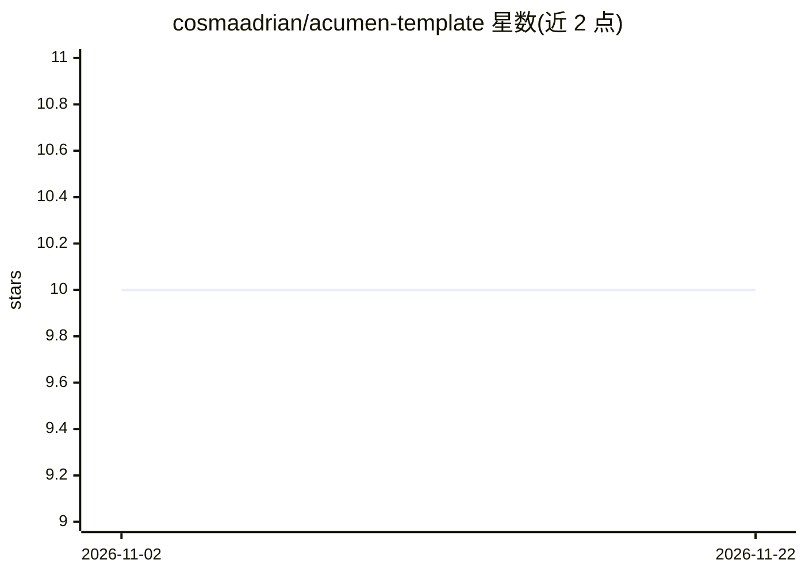

# cosmaadrian/acumen-template

⭐ 10 · Python · GPL-3.0 · 推送 2026-11-02 · [GitHub](https://github.com/cosmaadrian/acumen-template) · 个人维护

**给深度学习科研人员提供开箱即用的 PyTorch 项目模板**

基于 cookiecutter 生成的深度学习研究项目模板，假定使用 PyTorch 与 wandb，通过 YAML 配置文件与命令行参数以声明式方式运行实验。框架自动处理训练循环与实验跟踪，默认提供 checkpoint、early stopping、日志等回调，研究者只需编写数据处理、训练与评估逻辑。附带 lib/forge.py 命令行工具用于管理项目、生成 Datasets/Models/Trainers/Evaluators 类及更新 lib/ 目录。README 列出多篇使用该模板发表的论文。

## 筛选速览

| 维度 | 判定 | 备注 |
|---|---|---|
| AI 角色 | `ai-ecosystem` | LLM/agent 周边工具 |
| 许可风险 | `viral` | GPL-3.0 |
| 部署形态 | `None` |  |
| 模型依赖 | — | README 未给出锁定关系 |
| 硬件要求 | — | 无带数字的原话,不猜 |
| 安装摩擦 | `low` | 无编译、无系统依赖或容器化 |
| 成熟度 | — | 结构信号不足 |

## 能力要点

- cookiecutter 一条命令生成项目结构
- YAML 配置支持 extends/includes/值引用三种组合方式
- 内置训练循环、实验跟踪与 checkpoint/early stopping/日志回调
- lib/forge.py 提供项目管理与模板更新命令

## 适用场景

- 启动新的深度学习研究项目时快速搭建代码骨架
- 用声明式 YAML 配置管理多组实验
- 在科研项目中统一接入 wandb 实验跟踪

## 场景标签

`科研工具` · 领域:学习与行业

## 证据(README 行号)

> L39: This project's goal is to provide a ready-made deep learning research project structure. This template / framework 
> L41: It is heavily based on `.yaml` configuration files and command line arguments to run experiments in a declarative w

## 星数曲线

2026-11-02 10 → 2026-11-22 10（+0）

---
*卡片 v1 · prompt 1.4 · 生成 2026-11-19 · 置信度 high · 依据 README sha `81496f2509f5` · [字段定义](../../DATASET.md)*
