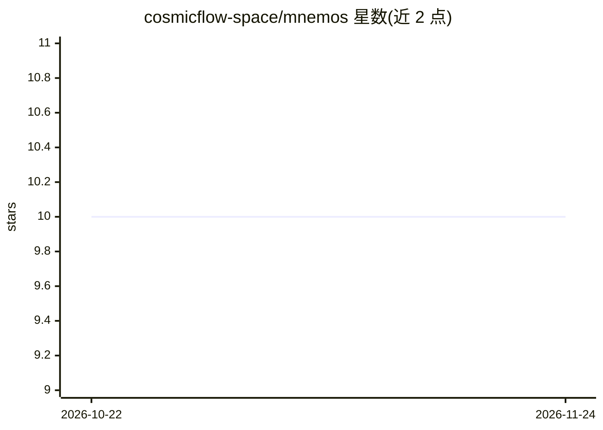

# cosmicflow-space/mnemos

⭐ 10 · TypeScript · MIT · 推送 2026-10-29 · [GitHub](https://github.com/cosmicflow-space/mnemos) · [官网](https://zenalgo.ai) · 个人维护

**本地优先的个人 RAG：丢入文件夹即可带引用问答**

以 TypeScript + Next.js 构建的个人检索增强问答系统，默认 100% 本地运行：文档在本地用 BGE-small 嵌入索引，聊天默认走本地 Ollama，答案带指向源文件块的引用，审计日志记录每次查询。可选接入 Anthropic Claude/OpenAI（仅发送检索块，不发送原始文件），提供桌面 Web 与私有 Telegram 机器人两种入口，支持 /do 文件模糊查找入库、/focus 单文件聚焦、单字符前缀的模型路由，支持 macOS/Linux/Windows。

## 筛选速览

| 维度 | 判定 | 备注 |
|---|---|---|
| AI 角色 | `ai-native` | 本体是模型或模型工具 |
| 许可风险 | `permissive` | MIT |
| 部署形态 | `self-host` | docker 或自建部署 |
| 模型依赖 | local-ok | 支持本地模型 |
| 硬件要求 | — | 无带数字的原话,不猜 |
| 安装摩擦 | `low` | 无编译、无系统依赖或容器化 |
| 成熟度 | — | 结构信号不足 |

## 能力要点

- 默认全本地：本地嵌入与本地 Ollama 聊天，答案带精确到源块的引用
- Telegram 私有机器人，仅出站长轮询，无需公网 IP，文件不出本机
- 单字符前缀模型路由（!/+/!! 等）在本地与云端模型间切换
- 审计日志记录 provider、模型、chunk ID、token 估算与延迟

## 适用场景

- 把个人文档文件夹变成可问答的带引用知识库
- 手机上通过 Telegram 随时查询家中电脑上的资料
- 隐私优先场景下用本地模型替代云端问答

## 场景标签

`RAG` `文档问答` · 领域:知识与检索

## 证据(README 行号)

> L12: Mnemos is a personal RAG (retrieval-augmented generation) system that defaults to **100% local** — embeddings on yo
> L119: Mnemos's standout feature: **a single leading character on your message decides how it's answered** — whether to s

## 星数曲线

2026-10-22 10 → 2026-11-24 10（+0）

---
*卡片 v1 · prompt 1.4 · 生成 2026-11-19 · 置信度 mid · 依据 README sha `6b2727e21710` · [字段定义](../../DATASET.md)*
