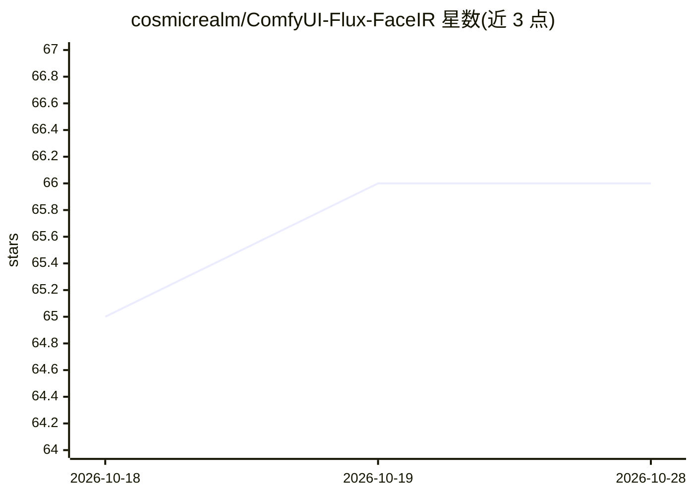

# cosmicrealm/ComfyUI-Flux-FaceIR

⭐ 66 · Python · Apache-2.0 · 推送 2026-08-23 · [GitHub](https://github.com/cosmicrealm/ComfyUI-Flux-FaceIR) · 组织维护

**ComfyUI 人脸修复扩展：FLUX.2 + LoRA 做盲修复与参考引导修复**

ComfyUI 自定义节点扩展，封装 FLUX FaceIR 人脸修复流程：支持预对齐人脸块的直接修复，以及全图路径——用 RetinaFace 检测并对齐人脸、用 FaceIR LoRA（基于 FLUX.2-klein-base-4B）修复、导出仿射参数并贴回原图。提供 5 个核心节点与两个内置工作流，支持盲修复与最多三张参考图的参考引导修复。模型权重需单独下载，扩展本身不自动下载；主训练/推理仓库为 cosmicrealm/flux-restoration。

## 筛选速览

| 维度 | 判定 | 备注 |
|---|---|---|
| AI 角色 | `ai-native` | 本体是模型或模型工具 |
| 许可风险 | `permissive` | Apache-2.0 |
| 部署形态 | `None` |  |
| 模型依赖 | — | README 未给出锁定关系 |
| 硬件要求 | — | 无带数字的原话,不猜 |
| 安装摩擦 | `low` | 无编译、无系统依赖或容器化 |
| 成熟度 | — | 结构信号不足 |

## 能力要点

- RetinaFace 检测对齐 + FaceIR 修复 + 参数导出 + 贴回的全图工作流
- 支持盲修复与最多三张参考图的参考引导修复
- 提供 5 个核心节点与 2 个内置工作流模板
- crop_scale/crop_shift_y/检测阈值等参数在检测对齐节点上可调

## 适用场景

- 在 ComfyUI 中对老照片或降质图像做人脸修复
- 保留人物身份的参考图引导人脸增强
- 处理整图中的多步人脸检测-修复-贴回流水线

## 场景标签

`图像生成` `图像视频处理` · 领域:内容生成

## 证据(README 行号)

> L3: ComfyUI extension for FLUX FaceIR face restoration. It supports both:
> L24: 4. restore the aligned degraded face with FaceIR

## 星数曲线

2026-10-18 65 → 2026-10-28 66（+1）

---
*卡片 v1 · prompt 1.4 · 生成 2026-10-24 · 置信度 high · 依据 README sha `23993487e2c8` · [字段定义](../../DATASET.md)*
