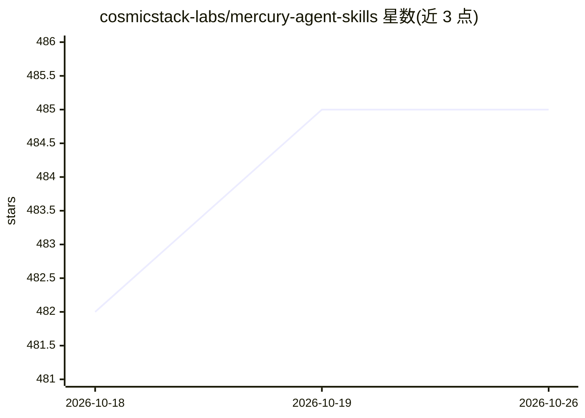

# cosmicstack-labs/mercury-agent-skills

⭐ 485 · JavaScript · MIT · 推送 2026-08-25 · [GitHub](https://github.com/cosmicstack-labs/mercury-agent-skills) · [官网](https://skills.mercuryagent.sh) · 组织维护

**AI agent 技能清单库：132 个 SKILL.md 供多 agent 安装使用**

开源的 SKILL.md 技能策展库，收录 132 个技能、按 23 个类别（开发、AI/ML、后端、DevOps、自动化等）组织。技能兼容 Mercury、Claude Code、Codex CLI、OpenClaw、Hermes、Cursor、Gemini CLI 等读取 SKILL.md 格式的 agent。安装途径包括 Mercury CLI 命令、网站 skills.mercuryagent.sh 的复制粘贴命令，或 git clone 整库后放入对应 agent 的技能目录。配套网站提供搜索、排行榜、书签与公开 JSON feed。技能库面向 Mercury Agent 运行时，由 Cosmic Stack 维护，MIT 许可。

## 筛选速览

| 维度 | 判定 | 备注 |
|---|---|---|
| AI 角色 | `ai-knowledge` | 知识聚合/清单类 |
| 许可风险 | `permissive` | MIT |
| 部署形态 | `library` | 以包/库形式分发 |
| 模型依赖 | — | README 未给出锁定关系 |
| 硬件要求 | — | 无带数字的原话,不猜 |
| 安装摩擦 | `low` | 无编译、无系统依赖或容器化 |
| 成熟度 | — | 结构信号不足 |

## 能力要点

- 132 个 SKILL.md 技能，23 个类别组织
- 单一 SKILL.md 格式兼容 7 种主流 agent 运行时
- Mercury CLI 一条命令安装，支持版本固定与失败回滚
- 配套网站提供全文搜索、排行榜与公开 JSON feed（/api/feed.json）

## 适用场景

- 为我的 agent 运行时挑选现成技能，避免逐个手写
- 通过 Mercury CLI 搜索并安装开发、测试、自动化等技能
- 工具开发者利用公开 JSON feed 获取技能索引

## 场景标签

`精选清单` · 领域:学习与行业

## 证据(README 行号)

> L10: **An open-source library of `SKILL.md` playbooks for AI agents.** Browse and install on skills.mercuryagent.sh, or 
> L12: **132 skills across 23 categories** — hand-curated, production-ready, and compatible with every major agent: Mercur

## 星数曲线

2026-10-18 482 → 2026-10-26 485（+3）

---
*卡片 v1 · prompt 1.4 · 生成 2026-10-21 · 置信度 mid · 依据 README sha `020007a99fd7` · [字段定义](../../DATASET.md)*
