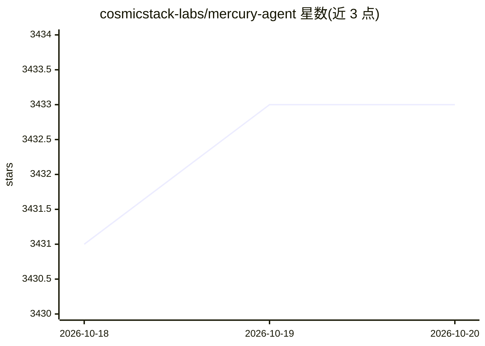

# cosmicstack-labs/mercury-agent

⭐ 3,433 · TypeScript · MIT · 推送 2026-10-19 · [GitHub](https://github.com/cosmicstack-labs/mercury-agent) · [官网](https://mercuryagent.sh/) · 组织维护 · 中文 README

**常驻本地的个人 AI agent：多通道对话、权限管控与记忆**

以单一后台进程运行的开源 agent，可通过终端、Telegram、Discord、Slack、Signal 与本地 Web 仪表盘访问同一 agent 与同一记忆。内置约 50 个工具（文件、shell、git、GitHub、web、调度、子 agent），文件访问按文件夹划定读写范围，shell 命令经黑名单与审批步骤，每轮受每日 token 预算约束。记忆以 SQLite（FTS5）存于本地 ~/.mercury。支持 DeepSeek、OpenAI、Anthropic、Grok、Ollama（云与本地）、LM Studio 及 OpenAI 兼容端点，含自动回退。安装提供一键脚本与 npm（Node.js 22+），运行于 macOS/Linux/Windows/Termux。

## 筛选速览

| 维度 | 判定 | 备注 |
|---|---|---|
| AI 角色 | `ai-native` | 本体是模型或模型工具 |
| 许可风险 | `permissive` | MIT |
| 部署形态 | `library` | 以包/库形式分发 |
| 模型依赖 | local-ok | 支持本地模型 |
| 硬件要求 | — | 无带数字的原话,不猜 |
| 安装摩擦 | `low` | 无编译、无系统依赖或容器化 |
| 成熟度 | — | 结构信号不足 |

## 能力要点

- 单一后台进程承载全部通道与记忆，崩溃自动恢复并以登录服务常驻
- 权限系统：shell 黑名单、按文件夹的读写范围、审批提示、SSRF 防护、日志密钥脱敏
- Second Brain：10 类记忆类型，SQLite + FTS5 本地存储，答案前自动召回
- Mercury Code 仓库内编码（测试通过才算完成）与 Mercury Bots 持久专家 agent 舰队

## 适用场景

- 通过 Telegram/Discord/Slack/Signal 等消息渠道随时指挥同一个本地 agent
- 让 agent 按日程与预算在后台完成任务并交付文件
- 在仓库内用 Mercury Code 做经验证的编码工作

## 场景标签

`AI 助手` `知识库管理` `编码 Agent` · 领域:编码与开发

## 证据(README 行号)

> L24: Mercury is an open-source agent with a personality you write yourself, a memory that stays on your disk, and a perm
> L42: |**Models**|DeepSeek, OpenAI, Anthropic, Grok, Ollama (cloud and local), LM Studio, any OpenAI-compatible endpoint,

## 星数曲线

2026-10-18 3,431 → 2026-10-20 3,433（+2）

---
*卡片 v1 · prompt 1.4 · 生成 2026-10-20 · 置信度 high · 依据 README sha `72f53b17f927` · [字段定义](../../DATASET.md)*
