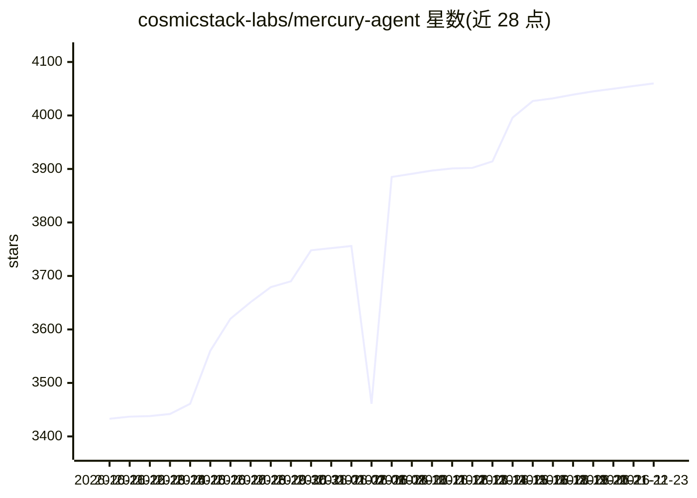

# cosmicstack-labs/mercury-agent

⭐ 4,060 · TypeScript · MIT · 推送 2026-11-22 · [GitHub](https://github.com/cosmicstack-labs/mercury-agent) · [官网](https://mercuryagent.sh/) · 组织维护 · 中文 README

**本地常驻个人 AI agent：权限管控、记忆与多渠道接入**

运行在用户机器上的开源 AI agent：单个后台进程承载终端、Telegram、Discord、Slack、Signal 与本地 Web 看板等多个渠道，共享同一套权限、记忆与预算。内置约 50 个工具（文件、shell、git、GitHub、网络、调度器、子 agent），shell 命令经黑名单与审批步骤，文件按文件夹限定读写范围，每日 token 预算在每轮强制生效。记忆为本地 SQLite 文件，人格由可编辑的 Markdown 文件定义。另提供 Mercury Code 编码会话与 Mercury Bots 持久化子 agent，支持 macOS/Linux/Windows 与 Termux。

## 筛选速览

| 维度 | 判定 | 备注 |
|---|---|---|
| AI 角色 | `ai-native` | 本体是模型或模型工具 |
| 许可风险 | `permissive` | MIT |
| 部署形态 | `library` | 以包/库形式分发 |
| 模型依赖 | local-ok | 支持本地模型 |
| 硬件要求 | — | 无带数字的原话,不猜 |
| 安装摩擦 | `low` | 无编译、无系统依赖或容器化 |
| 成熟度 | — | 结构信号不足 |

## 能力要点

- 多渠道访问同一常驻 agent：终端、Telegram、Discord、Slack、Signal、本地 Web 看板
- 权限体系：shell 不可覆盖黑名单、按文件夹读写范围、审批提示、每日 token 预算
- Second Brain 本地记忆：SQLite+FTS5，10 种记忆类型，自动抽取与召回
- Mercury Code 仅在构建/测试/类型检查通过后报告任务完成

## 适用场景

- 通过终端或 Telegram 与个人 AI 助手对话并执行文件与命令任务
- 在仓库内用编码会话完成任务并通过测试验证
- 按 cron 调度运行子 agent 交付文件到指定目录

## 场景标签

`AI 助手` `编码 Agent` · 领域:编码与开发

## 证据(README 行号)

> L27: Mercury is an open-source agent with a personality you write yourself, a memory that stays on your disk, and a perm
> L45: |**Models**|DeepSeek, OpenAI, Anthropic, Grok, Ollama (cloud and local), LM Studio, any OpenAI-compatible endpoint,

## 星数曲线

2026-10-21 3,433 → 2026-11-23 4,060（+627）

---
*卡片 v1 · prompt 1.4 · 生成 2026-11-23 · 置信度 high · 依据 README sha `797f2bc2e938` · [字段定义](../../DATASET.md)*
