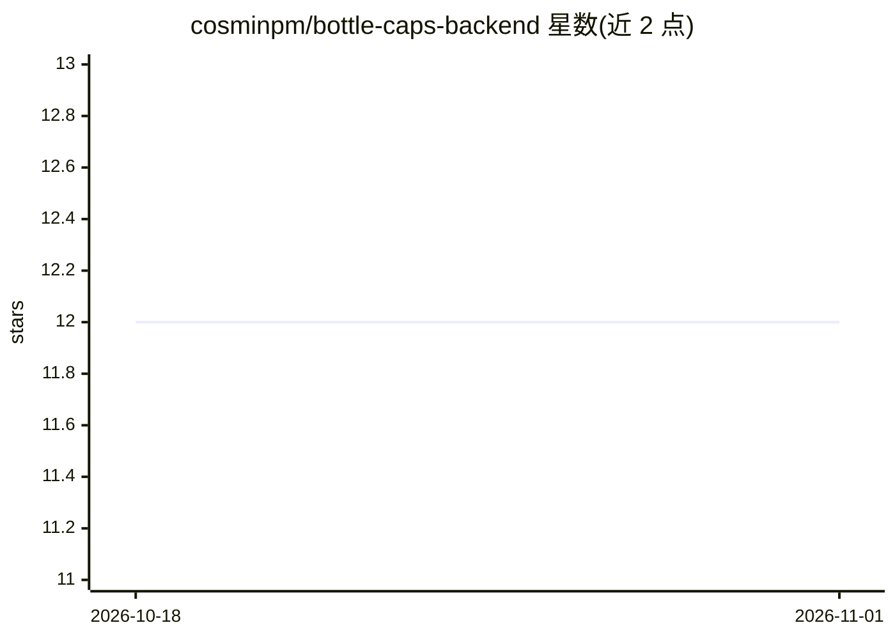

# cosminpm/bottle-caps-backend

⭐ 12 · Python · 推送 2025-11-13 · [GitHub](https://github.com/cosminpm/bottle-caps-backend) · 个人维护

**基于 OpenCV 的瓶盖检测与识别应用**

一个计算机视觉项目，通过 Simple Blob Detector 与 Hough Transform Circles 检测图像中的瓶盖位置，再用 MobilNet 模型将瓶盖转为向量，与 Pinecone 向量数据库中的数据进行比对以识别瓶盖。目前应用在本地运行，README 提及未来计划迁移到云端。识别效果存在误标（示例中底部两个瓶盖标注错误），拍摄背景要求白色或高对比度，作者标注速度优化待改进。

## 筛选速览

| 维度 | 判定 | 备注 |
|---|---|---|
| AI 角色 | `ai-native` | 本体是模型或模型工具 |
| 许可风险 | `none` | — |
| 部署形态 | `None` |  |
| 模型依赖 | — | README 未给出锁定关系 |
| 硬件要求 | — | 无带数字的原话,不猜 |
| 安装摩擦 | `low` | 无编译、无系统依赖或容器化 |
| 成熟度 | — | 结构信号不足 |

## 能力要点

- Simple Blob Detector 先定位再由 Hough Transform Circles 确定圆位置的两阶段检测
- MobilNet 生成向量并与 Pinecone 向量数据库比对识别
- scripts/generate_model.py 生成数据并上传 Pinecone

## 适用场景

- 对白色背景图像中的瓶盖做自动检测
- 将瓶盖图像与已有向量库比对识别种类

## 场景标签

`目标检测` · 领域:感知与多模态

## 证据(README 行号)

> L3: The idea of this project it's to have a machine learning app that will detect and identify bottlecaps from a source.
> L7: bottle-caps uses computer vision techniques, primarily based on OpenCV, to identify and match bottle caps. While the

## 星数曲线

2026-10-18 12 → 2026-11-01 12（+0）

---
*卡片 v1 · prompt 1.4 · 生成 2026-11-01 · 置信度 mid · 依据 README sha `41dfa96f192e` · [字段定义](../../DATASET.md)*
