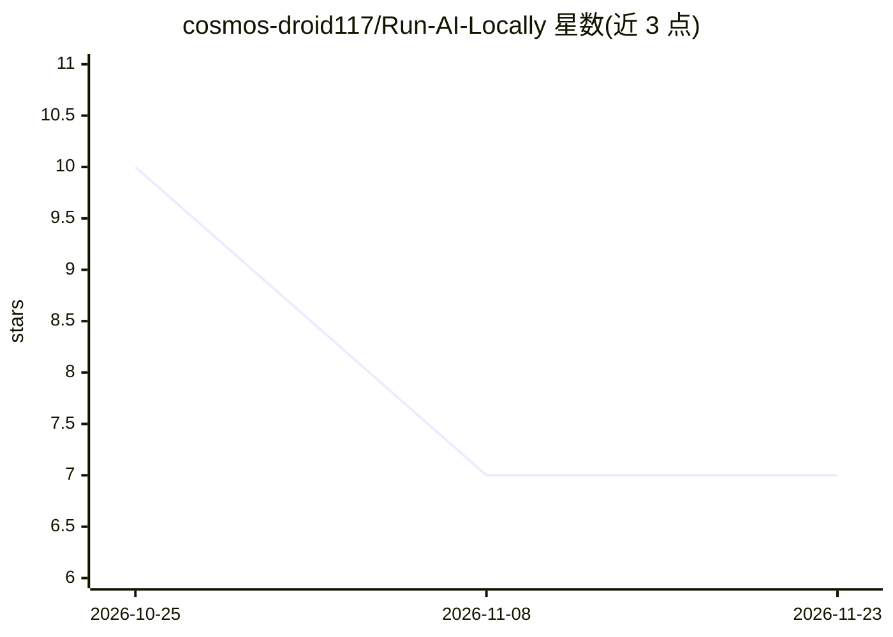

# cosmos-droid117/Run-AI-Locally

⭐ 7 · MIT · 推送 2026-10-24 · [GitHub](https://github.com/cosmos-droid117/Run-AI-Locally) · 个人维护

**本地离线运行大模型的入门指南与硬件选型工具**

面向初学者的本地大模型运行指南：以 Ollama 作为运行路径，按内存/GPU 显存大小给出对应模型与运行命令的对照表（8–64GB 分档），并附带一个免安装的 Windows 工具 script.exe，自动检测硬件并给出可运行的命令。内容覆盖首次运行、按任务选模型、卡慢与内存不足排查等教程。README 标注 2026 年 10 月验证，支持 Windows/macOS/Linux。

## 筛选速览

| 维度 | 判定 | 备注 |
|---|---|---|
| AI 角色 | `ai-knowledge` | 知识聚合/清单类 |
| 许可风险 | `permissive` | MIT |
| 部署形态 | `desktop` | 安装包/桌面程序 |
| 模型依赖 | local-ok | 支持本地模型 |
| 硬件要求 | `cpu-ok` | |
| 安装摩擦 | `low` | 无编译、无系统依赖或容器化 |
| 成熟度 | — | 结构信号不足 |

## 能力要点

- script.exe 自动检测硬件并推荐模型，免安装、无需 Python
- 按 RAM/VRAM 分档（8/16/32/64GB+）给出模型与命令对照表
- 量化模型内存估算：下载体积加 2-3GB 余量
- 附 CPU 推理速度参考（14B 约 6-10 tokens/s）

## 适用场景

- 在个人笔记本上免费离线运行对话模型
- 不确定内存够跑哪个模型时获取推荐命令
- 查找编码/写作/推理等任务的模型选择建议

## 场景标签

`教程课程` · 领域:学习与行业

## 证据(README 行号)

> L14: ## Quick start (5 minutes)
> L44: Full guide with use-case picks (coding, writing, reasoning): docs/choose-a-model.md

## 星数曲线

2026-10-25 10 → 2026-11-23 7（-3）

---
*卡片 v1 · prompt 1.4 · 生成 2026-11-20 · 置信度 high · 依据 README sha `37ec0bc3aae7` · [字段定义](../../DATASET.md)*
