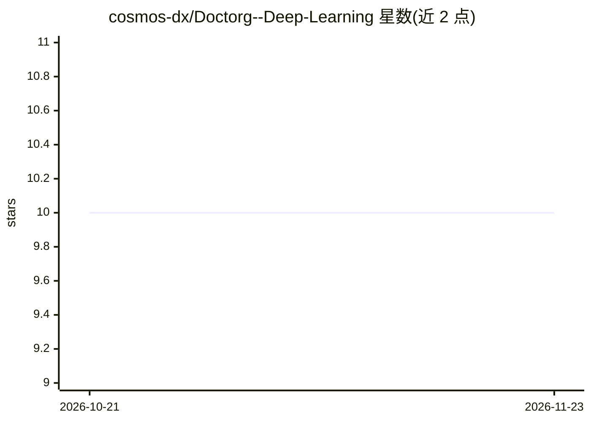

# cosmos-dx/Doctorg--Deep-Learning

⭐ 10 · Python · MIT · 推送 2026-04-19 · [GitHub](https://github.com/cosmos-dx/Doctorg--Deep-Learning) · [官网](https://www.youtube.com/watch?v=dWQDwx1dNwc) · 个人维护

**面向用户的多智能体 AI 医疗咨询平台，基于症状给出分诊与诊断建议**

由 FastAPI 后端与 Next.js PWA 前端组成的医疗咨询系统，调用 OpenAI GPT-4o 运行 6 个专职 agent：安全护栏（急症检测、拒绝开药）、RAG 知识检索（FAISS 索引自建疾病数据集 + PostgreSQL 会话记忆）、分诊、鉴别诊断、生活建议与追问澄清，响应经 SSE 流式返回。部署依赖 Docker 或手动搭建 Python/Node 环境，需 OpenAI API Key；内置免费/付费会话限额，声明仅作教育用途，非专业医疗替代。

## 筛选速览

| 维度 | 判定 | 备注 |
|---|---|---|
| AI 角色 | `ai-native` | 本体是模型或模型工具 |
| 许可风险 | `permissive` | MIT |
| 部署形态 | `self-host` | docker 或自建部署 |
| 模型依赖 | — | README 未给出锁定关系 |
| 硬件要求 | — | 无带数字的原话,不猜 |
| 安装摩擦 | `low` | 无编译、无系统依赖或容器化 |
| 成熟度 | — | 结构信号不足 |

## 能力要点

- 6 个专职 agent 协作的咨询流水线（护栏/检索/分诊/诊断/建议/追问）
- FAISS + sentence-transformers 构建医学知识索引，含会话历史记忆
- PWA 支持安装到主屏与离线缓存、断线消息排队
- Docker Compose 一键部署，含健康检查与可选 GPU 支持

## 适用场景

- 输入症状获得分诊建议与 3-5 个可能病症的鉴别诊断
- 搭建带安全护栏和 RAG 记忆的多智能体医疗问答原型
- 作为学习多 agent 系统与 RAG 架构的实践项目

## 场景标签

`多智能体` `RAG` · 领域:Agent 开发

## 证据(README 行号)

> L3: An intelligent multi-agent medical consultation system powered by OpenAI GPT-4o, featuring specialized agents for tr
> L526: **⚠️ Medical Disclaimer**: DoctorG is an AI assistant for educational purposes only. It is NOT a substitute for pr

## 星数曲线

2026-10-21 10 → 2026-11-23 10（+0）

---
*卡片 v1 · prompt 1.4 · 生成 2026-11-19 · 置信度 high · 依据 README sha `a0b6e1a53c7d` · [字段定义](../../DATASET.md)*
