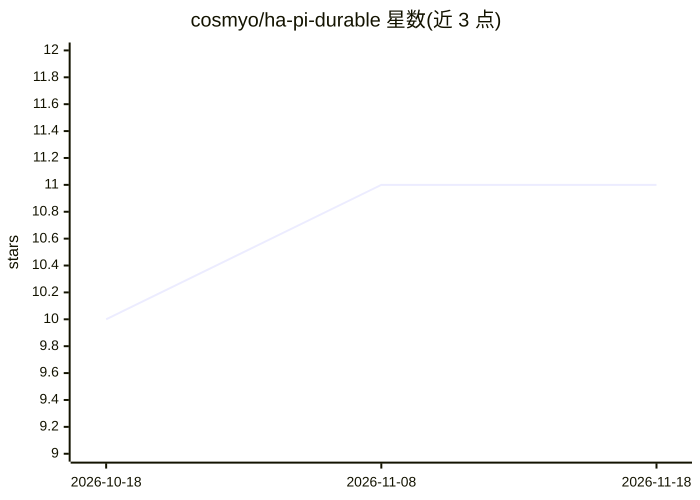

# cosmyo/ha-pi-durable

⭐ 11 · TypeScript · MIT · 推送 2026-11-01 · [GitHub](https://github.com/cosmyo/ha-pi-durable) · 个人维护

**Home Assistant 的持久化 AI 代理：审核后控制灯具开关**

面向 Home Assistant OS 的实验性第三方 App（add-on），将对话代理与持久化执行结合：输入、任务检查点、对话记录写入 SQLite（synchronous=FULL），断线后可恢复到已提交状态。Home 模式提供范围受限的实体读取与不可变的灯/开关操作提案，动作默认禁用，启用后默认要求人工逐条批准；另提供独立隔离的 Code 模式工作容器与可选的本地风险评审 add-on（Hearth Judge）。需 Home Assistant OS 与管理员账户，主机为 amd64 或 aarch64。

## 筛选速览

| 维度 | 判定 | 备注 |
|---|---|---|
| AI 角色 | `ai-native` | 本体是模型或模型工具 |
| 许可风险 | `permissive` | MIT |
| 部署形态 | `None` |  |
| 模型依赖 | local-ok | 支持本地模型 |
| 硬件要求 | — | 无带数字的原话,不猜 |
| 安装摩擦 | `low` | 无编译、无系统依赖或容器化 |
| 成熟度 | `idea` | |

## 能力要点

- Pi Durable 持久化：检查点与对话写入 SQLite，可重连恢复
- Home 模式人工审批：动作默认禁用，默认 Ask 逐条确认
- Code 模式在独立非 root、无网络的 worker 容器中运行
- 可选 Hearth Judge：llama.cpp 服务器在本机运行开放权重模型

## 适用场景

- 通过对话查询与控制 Home Assistant 中的灯和开关，操作需人工批准
- 用语音卫星经 Assist 集成以个人权限发起家居指令
- 在 Home Assistant 主机上以本地模型运行代理而不调云端
- 需要任务中断后可恢复的家居代理实验环境

## 场景标签

`AI 助手` · 领域:对话与助手

## 证据(README 行号)

> L3: ### A durable AI agent for Home Assistant
> L16: - **Home mode.** Explicitly scoped HA reads, service discovery and immutable light/switch proposals. Empty scope de
> L66: - `local` (unreleased source): an OpenAI-compatible server on your private network (Ollama, LM Studio, llama.cpp, v

## 星数曲线

2026-10-18 10 → 2026-11-18 11（+1）

---
*卡片 v1 · prompt 1.4 · 生成 2026-11-18 · 置信度 high · 依据 README sha `7891e572a2b4` · [字段定义](../../DATASET.md)*
