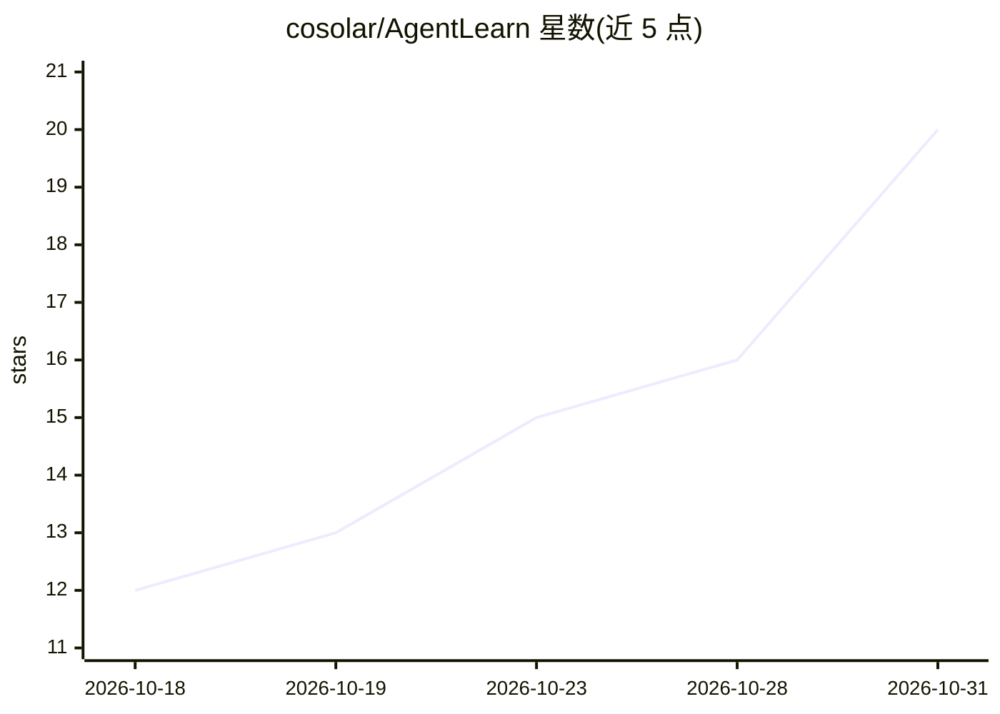

# cosolar/AgentLearn

⭐ 20 · Python · MIT · 推送 2026-10-13 · [GitHub](https://github.com/cosolar/AgentLearn) · [官网](https://docs.minims.cn/share/agentlearn) · 个人维护 · 中文 README

**AI Agent 系统化开源教程：80+ 篇文档与 12+ 实战项目**

面向从零基础到生产部署的学习者的 AI Agent 教程项目：9 大部分、80+ 篇文档、约 90 小时学习内容，路径覆盖基础概念、LangChain v1 实战、LangGraph 工作流、RAG、MCP/A2A 协议、多 Agent、生产部署与 Agent Harness 工程。配套 Python 包 agentlearn 与 12+ 个可运行示例，使用 uv 管理依赖，要求 Python 3.12+ 与任一 LLM API Key（OpenAI/Anthropic/通义/DeepSeek 等）。文档为 Docsify 站点，提供国内访问镜像。

## 筛选速览

| 维度 | 判定 | 备注 |
|---|---|---|
| AI 角色 | `ai-knowledge` | 知识聚合/清单类 |
| 许可风险 | `permissive` | MIT |
| 部署形态 | `library` | 以包/库形式分发 |
| 模型依赖 | — | README 未给出锁定关系 |
| 硬件要求 | — | 无带数字的原话,不猜 |
| 安装摩擦 | `low` | 无编译、无系统依赖或容器化 |
| 成熟度 | — | 结构信号不足 |

## 能力要点

- 9 大部分 80+ 篇教程，约 90 小时学习内容
- 配套 Python 包 agentlearn 与 12+ 个可运行实战项目
- 基于 LangChain v1 + LangGraph 1.2，覆盖 MCP/A2A 协议与生产部署
- 提供 10 周学习路线图与 Agent Harness（Model+Harness）专题章节

## 适用场景

- 系统学习从 Agent 概念到生产部署的完整路径
- 通过可运行示例上手 LangChain/LangGraph 开发
- 了解 2026 年 Agent 框架、协议与选型生态

## 场景标签

`教程课程` · 领域:学习与行业

## 证据(README 行号)

> L36: AgentLearn 是当前最系统的开源 AI Agent 教程之一，内容同步至 **2026 年 10 月** 的最新技术栈。无论你是 AI 新手还是资深后端开发者，都可以在这里找到适合自己的成长路径。
> L51: **已有 80+ 篇教程、~90 小时学习内容，全部免费开源。** 🚀

## 星数曲线

2026-10-18 12 → 2026-10-31 20（+8）

---
*卡片 v1 · prompt 1.4 · 生成 2026-10-30 · 置信度 mid · 依据 README sha `ee9210ab5473` · [字段定义](../../DATASET.md)*
