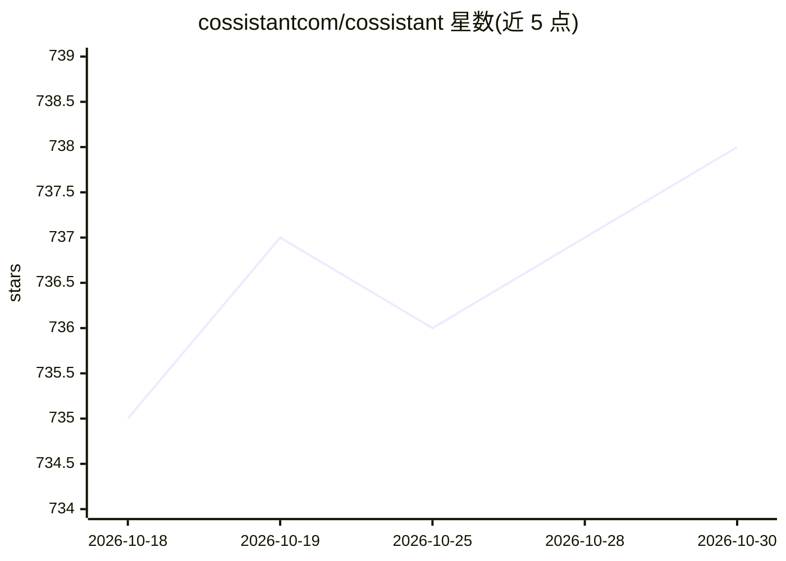

# cossistantcom/cossistant

⭐ 738 · TypeScript · AGPL-3.0 · 推送 2026-09-18 · [GitHub](https://github.com/cossistantcom/cossistant) · [官网](https://cossistant.com) · 组织维护

**开源 React 客服聊天组件：可定制 AI 客服 agent**

面向开发者与 SaaS 初创团队的 React 生态开源客服聊天 widget：提供 headless 组件、实时消息与配套后端基础设施，含可定制的 AI 客服 agent，采用代码优先与 API 驱动的设计。以 monorepo 形式组织，发布 @cossistant/react（headless hooks 与原语）与 @cossistant/next（Next.js 绑定）两个包；技术栈含 Hono/tRPC/Drizzle ORM/WebSockets，后端依赖 Docker 部署 Postgres 与 Redis。许可为 AGPL-3.0（非商业），商业使用需联系获取商业许可。

## 筛选速览

| 维度 | 判定 | 备注 |
|---|---|---|
| AI 角色 | `ai-enhanced` | 去掉 AI 部分产品仍成立 |
| 许可风险 | `dual` | AGPL-3.0 |
| 部署形态 | `None` |  |
| 模型依赖 | — | README 未给出锁定关系 |
| 硬件要求 | — | 无带数字的原话,不猜 |
| 安装摩擦 | `low` | 无编译、无系统依赖或容器化 |
| 成熟度 | — | 结构信号不足 |

## 能力要点

- React headless 组件 + 实时消息 + 配套后端基础设施
- 可定制的 AI 客服 agent
- 两个 npm 包：@cossistant/react 与 @cossistant/next
- 技术栈：Turborepo/Bun/TypeScript/tRPC/Drizzle ORM

## 适用场景

- 在我的 React/Next.js 应用里嵌入客服聊天 widget
- 搭建带 AI agent 的客服支持渠道
-  startups 为 SaaS 产品集成代码优先的客服方案

## 场景标签

`聊天机器人` · 领域:对话与助手

## 证据(README 行号)

> L3:  Open source chat &lt;Support /&gt; widget for React
> L13: Cossistant is an open source chat support widget for the React ecosystem. Built by developers, for developers who n

## 星数曲线

2026-10-18 735 → 2026-10-30 738（+3）

---
*卡片 v1 · prompt 1.4 · 生成 2026-10-21 · 置信度 mid · 依据 README sha `1a06f2f42fe0` · [字段定义](../../DATASET.md)*
