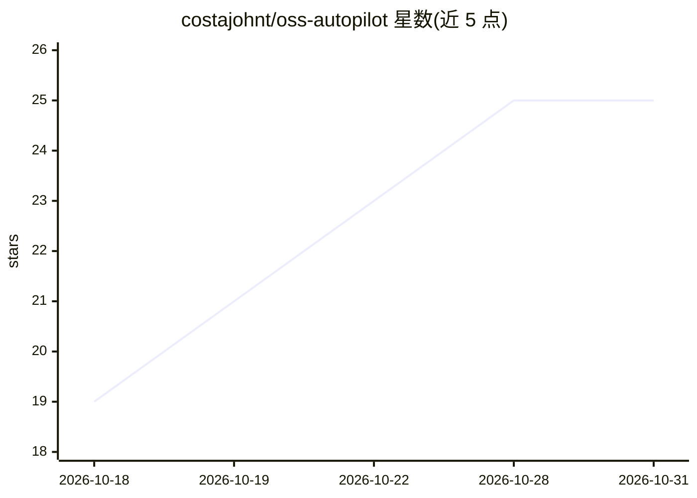

# costajohnt/oss-autopilot

⭐ 25 · TypeScript · MIT · 推送 2026-10-30 · [GitHub](https://github.com/costajohnt/oss-autopilot) · [官网](https://github.com/costajohnt/oss-autopilot#readme) · 个人维护

**管理开源贡献的 Claude Code 插件：追踪 PR、起草回复、找 issue**

面向多项目开源贡献者的贡献管理工具，以三种形态提供：Claude Code 插件、MCP 服务器和独立 CLI（共享同一核心库）。核心功能由 TypeScript 代码实现：拉取并分类 GitHub 上的开放 PR（CI 失败、待回复评论、冲突等）、issue 搜索与仓库评分、本地仪表盘与统计。AI 部分（Claude agent）负责读评审线程、起草回复或修复，所有推送和评论需用户逐条批准。首次运行需 npm 构建插件源码；Windows 未测试。

## 筛选速览

| 维度 | 判定 | 备注 |
|---|---|---|
| AI 角色 | `ai-enhanced` | 去掉 AI 部分产品仍成立 |
| 许可风险 | `permissive` | MIT |
| 部署形态 | `library` | 以包/库形式分发 |
| 模型依赖 | — | README 未给出锁定关系 |
| 硬件要求 | — | 无带数字的原话,不猜 |
| 安装摩擦 | `low` | 无编译、无系统依赖或容器化 |
| 成熟度 | — | 结构信号不足 |

## 能力要点

- 将开放 PR 分类为需要你处理/等待他人，并按优先级排序
- 8 个专职 agent：起草回复、诊断 CI、issue 甄别、评审前检查等
- MCP 服务器暴露 30 个工具、6 个资源、4 个提示词
- 无人值守 overnight 模式以 allowlist/deny list 阻止 git push 等写操作

## 适用场景

- 我同时给多个开源项目提 PR，想每天快速知道哪些需要我跟进
- 让 agent 起草对维护者反馈的回复，我自己审核后发出
- 按语言和标签寻找并甄别值得做的 issue

## 场景标签

`编码 Agent` · 领域:编码与开发

## 证据(README 行号)

> L213: - **The logic is code, not prompts.** PR status, CI failure categories (your bug, fork limitation, auth gate, flak
> L224: |Read your PRs, issues, CI logs|Yes|Yes|

## 星数曲线

2026-10-18 19 → 2026-10-31 25（+6）

---
*卡片 v1 · prompt 1.4 · 生成 2026-10-27 · 置信度 mid · 依据 README sha `bb67d4c86c1b` · [字段定义](../../DATASET.md)*
