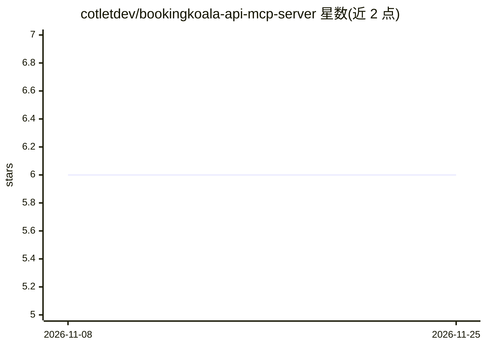

# cotletdev/bookingkoala-api-mcp-server

⭐ 6 · Python · NOASSERTION · 推送 2026-11-23 · [GitHub](https://github.com/cotletdev/bookingkoala-api-mcp-server) · [官网](https://cotlet.dev/integrations/bookingkoala-api-mcp-server) · 组织维护

**把 BookingKoala 接入 ChatGPT/Claude 等 AI agent 的 MCP 服务器**

为预订管理平台 BookingKoala 提供非官方的 API 与 MCP 服务器：通过 Chrome DevTools Protocol 读取用户登录会话的 cookie，以 curl_cffi 模拟浏览器 TLS 指纹调用店铺管理端接口，暴露 17 个工具（预订、报价、客户、员工、发票等），支持 stdio 与 streamable HTTP 两种 MCP 传输。面向想用自然语言让 AI 操作店铺的开发者与自托管用户；另有托管版 Cotlet 供非技术用户使用。需要 Python 3.11+ 与 Chrome，依赖店铺管理员账号权限。

## 筛选速览

| 维度 | 判定 | 备注 |
|---|---|---|
| AI 角色 | `ai-ecosystem` | LLM/agent 周边工具 |
| 许可风险 | `none` | NOASSERTION |
| 部署形态 | `library` | 以包/库形式分发 |
| 模型依赖 | locked-api |  |
| 硬件要求 | — | 无带数字的原话,不猜 |
| 安装摩擦 | `low` | 无编译、无系统依赖或容器化 |
| 成熟度 | — | 结构信号不足 |

## 能力要点

- 17 个 BookingKoala 工具以 MCP（stdio/HTTP）与 REST API（含 OpenAPI 文档）两种形式提供
- 通过 Chrome DevTools Protocol 读取会话 cookie，不存储密码
- 写入类工具标注告知客户端，执行前请求用户确认
- 同一服务另有托管版 Cotlet（7 天免费，一次性积分计费）

## 适用场景

- 让 Claude Code/Cursor 等客户端用自然语言处理未分配预订与派单
- 批量重发逾期发票、改期预订并发邮件通知客户
- 用 Python 脚本或 n8n/Make/Zapier 自动化店铺运营查询

## 场景标签

 · 领域:企业运营/SaaS 集成

## 证据(README 行号)

> L33: A **BookingKoala API** and a **BookingKoala MCP server** you run on your own computer, in Python, on the session of
> L35: BookingKoala has no public API and no official MCP server. Its API key only connects Zapier and Make, which react t
> L37: - **MCP server** for Claude Code, Claude Desktop, Cursor, Codex and any MCP client, over stdio or HTTP. Setup

## 星数曲线

2026-11-08 6 → 2026-11-25 6（+0）

---
*卡片 v1 · prompt 1.4 · 生成 2026-11-20 · 置信度 high · 依据 README sha `ed4a7181874e` · [字段定义](../../DATASET.md)*
