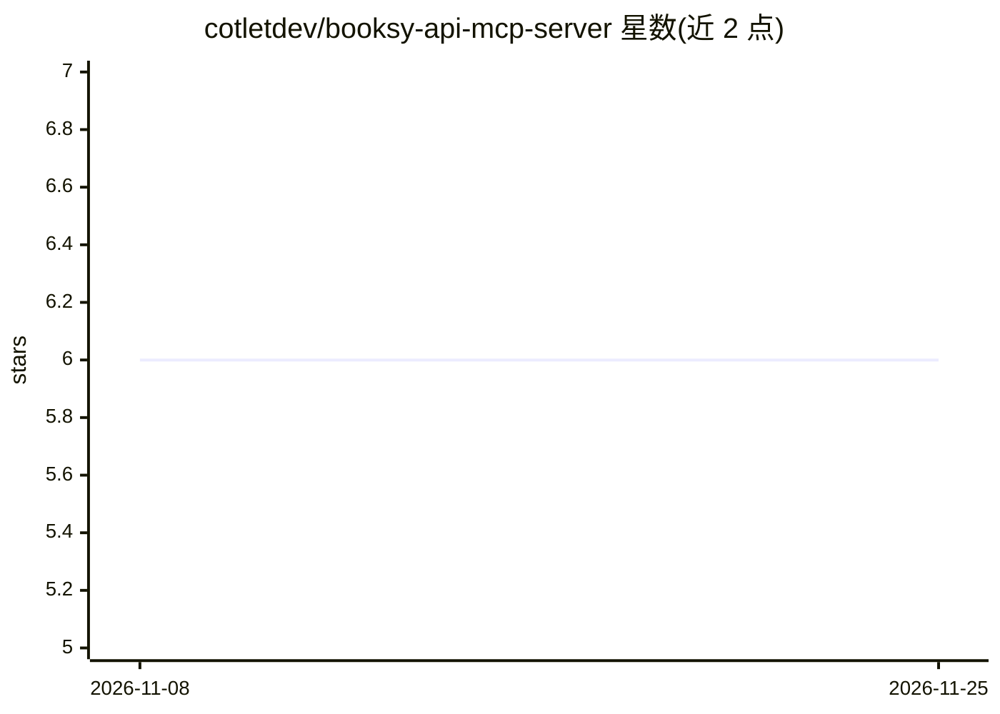

# cotletdev/booksy-api-mcp-server

⭐ 6 · Python · NOASSERTION · 推送 2026-11-23 · [GitHub](https://github.com/cotletdev/booksy-api-mcp-server) · [官网](https://cotlet.dev/integrations/booksy-api-mcp-server) · 组织维护

**把 Booksy 业务账户接入 ChatGPT/Claude 等 AI agent 的 MCP 服务器**

为预约管理平台 Booksy 提供自托管的 API 与 MCP 服务器：通过 Chrome DevTools Protocol 读取用户已登录的 Booksy Biz 会话，再以 curl_cffi 模拟 Chrome TLS 指纹调用 Booksy 网页面板所用的接口，暴露 28 个工具（日历、空档、客户、员工、评价、Message Blasts、统计报表），以 stdio/HTTP 的 MCP 与本地 REST API（含 OpenAPI 文档）两种形式提供。同一厂商另有托管版 Cotlet（7 天试用，付费额度包）。写操作工具被标记为需客户端确认。要求 Python 3.11+ 与 Chrome 144+。

## 筛选速览

| 维度 | 判定 | 备注 |
|---|---|---|
| AI 角色 | `ai-ecosystem` | LLM/agent 周边工具 |
| 许可风险 | `none` | NOASSERTION |
| 部署形态 | `library` | 以包/库形式分发 |
| 模型依赖 | — | README 未给出锁定关系 |
| 硬件要求 | — | 无带数字的原话,不猜 |
| 安装摩擦 | `low` | 无编译、无系统依赖或容器化 |
| 成熟度 | — | 结构信号不足 |

## 能力要点

- 28 个 Booksy Biz 工具以 MCP（stdio/HTTP）和本地 REST API 提供
- 通过 Chrome DevTools Protocol 读取已登录会话，不存储密码
- 写客户类工具标记只读/需确认属性，供 MCP 客户端拦截
- 附 9 个 Python 示例脚本与 curl 调用方式

## 适用场景

- 让 Claude/Cursor 等 agent 用自然语言查询和调整门店日历
- 用脚本批量读取预约、客户与营收统计
- 在 n8n/Make/Zapier 中通过 REST API 自动化 Booksy 操作

## 场景标签

 · 领域:商业软件集成/自动化

## 证据(README 行号)

> L35: Booksy has no self-serve API for business owners and no official MCP server. This repo gives you both:
> L37: - **MCP server** for Claude Code, Claude Desktop, Cursor, Codex and any MCP client, over stdio or HTTP. Setup
> L100: AI agent (MCP) / script (REST, Python) ──▶ booksy-mcp on your computer ──your Booksy session──▶ <country>.booksy.c

## 星数曲线

2026-11-08 6 → 2026-11-25 6（+0）

---
*卡片 v1 · prompt 1.4 · 生成 2026-11-20 · 置信度 high · 依据 README sha `962d71c9663a` · [字段定义](../../DATASET.md)*
