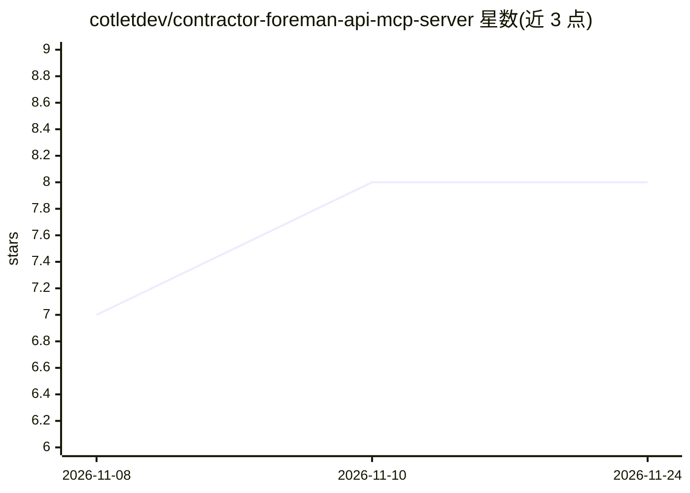

# cotletdev/contractor-foreman-api-mcp-server

⭐ 8 · Python · NOASSERTION · 推送 2026-11-23 · [GitHub](https://github.com/cotletdev/contractor-foreman-api-mcp-server) · [官网](https://cotlet.dev/integrations/contractor-foreman-api-mcp-server) · 组织维护

**把 Contractor Foreman 接入 ChatGPT/Claude 等 AI agent 的 MCP 服务器**

为建筑承包商管理软件 Contractor Foreman 提供非官方的 API 与 MCP 服务器：因 Contractor Foreman 无公开 API，该项目通过读取用户 Chrome 中的登录会话 cookie（DevTools Protocol）并以 curl_cffi 模拟浏览器 TLS 指纹，访问其 Web 端相同的接口，提供 89 个覆盖项目、排期、日报、估价、发票、成本核算等模块的工具。支持 stdio/HTTP 两种 MCP 传输，同时暴露本地 REST API（带 OpenAPI 文档）与 Python 调用接口及 10 个示例脚本。同一公司另提供托管版 Cotlet。许可为 Elastic 2.0，自用含商用免费。

## 筛选速览

| 维度 | 判定 | 备注 |
|---|---|---|
| AI 角色 | `ai-ecosystem` | LLM/agent 周边工具 |
| 许可风险 | `none` | NOASSERTION |
| 部署形态 | `library` | 以包/库形式分发 |
| 模型依赖 | — | README 未给出锁定关系 |
| 硬件要求 | — | 无带数字的原话,不猜 |
| 安装摩擦 | `low` | 无编译、无系统依赖或容器化 |
| 成熟度 | — | 结构信号不足 |

## 能力要点

- 89 个 Contractor Foreman 工具，覆盖项目、排期、日报、估价、发票、成本核算等模块
- MCP 服务器（stdio/HTTP）+ 本地 REST API + Python 调用三种接入方式
- 通过 Chrome DevTools Protocol 读取会话 cookie，不存储密码
- 工具带只读标记与发信前确认提示

## 适用场景

- 让 Claude Code/Cursor 等 MCP 客户端用自然语言操作 Contractor Foreman
- 用 Python 脚本或 REST API 批量读取项目、估价与发票数据
- 在 n8n/Make/Zapier 中自动化施工管理流程（配合托管版）

## 场景标签

 · 领域:建筑施工管理/AI 工具接入

## 证据(README 行号)

> L35: Contractor Foreman has no public API and no official MCP server. This repo gives you both:
> L37: - **MCP server** for Claude Code, Claude Desktop, Cursor, Codex and any MCP client, over stdio or HTTP. Setup
> L38: - **REST API** on `http://127.0.0.1:8787/api/v1/contractor-foreman`, with OpenAPI docs at `/docs`. Setup

## 星数曲线

2026-11-08 7 → 2026-11-24 8（+1）

---
*卡片 v1 · prompt 1.4 · 生成 2026-11-20 · 置信度 high · 依据 README sha `7ae28ea99492` · [字段定义](../../DATASET.md)*
