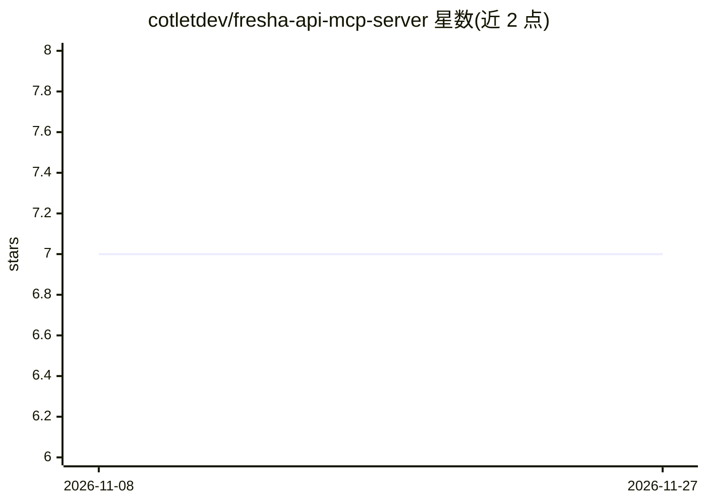

# cotletdev/fresha-api-mcp-server

⭐ 7 · Python · NOASSERTION · 推送 2026-11-23 · [GitHub](https://github.com/cotletdev/fresha-api-mcp-server) · [官网](https://cotlet.dev/integrations/fresha-api-mcp-server) · 组织维护

**让 AI 代理操作 Fresha 门店系统的 MCP 服务器与本地 API**

为 Fresha（美容美发沙龙管理平台）提供非官方的 17 个工具接口，以 MCP 服务器与本地 REST API 两种形式运行：通过 Chrome DevTools Protocol 读取用户自己的 Fresha 登录会话 Cookie，以 curl_cffi 模拟 Chrome TLS 指纹调用 Fresha 合作伙伴面板使用的内部 API，支持日历查询、预约管理、客户、评价回复与销售报表。写操作工具标记为需客户端确认。另有托管版 Cotlet 面向非技术店主，本仓库面向会用 Python 与终端的开发者，License 为 Elastic 2.0。

## 筛选速览

| 维度 | 判定 | 备注 |
|---|---|---|
| AI 角色 | `ai-ecosystem` | LLM/agent 周边工具 |
| 许可风险 | `none` | NOASSERTION |
| 部署形态 | `library` | 以包/库形式分发 |
| 模型依赖 | — | README 未给出锁定关系 |
| 硬件要求 | — | 无带数字的原话,不猜 |
| 安装摩擦 | `low` | 无编译、无系统依赖或容器化 |
| 成熟度 | — | 结构信号不足 |

## 能力要点

- 17 个 Fresha 工具：预约、空闲时段、客户、服务与团队、销售报表、评价回复
- 通过 Chrome DevTools Protocol 读取本机会话 Cookie，不存储密码与验证码
- MCP over stdio 或 HTTP，另提供带 OpenAPI 文档的本地 REST API 与 Python 调用接口及 9 个示例脚本
- 可写操作标记只读/需确认，写触达客户的操作先经用户同意

## 适用场景

- 让 ChatGPT/Claude 等代理查询日历、找空档并代为预约
- 批量回复未回复的客户评价并起草答复
- 从本地脚本或 n8n/Make/Zapier 读取与操作 Fresha 门店数据

## 场景标签

`工作流自动化` · 领域:效率与自动化

## 证据(README 行号)

> L33: A **Fresha API** and a **Fresha MCP server** you run on your own computer, in Python, on the session of your own Go
> L37: - **MCP server** for Claude Code, Claude Desktop, Cursor, Codex and any MCP client, over stdio or HTTP. Setup
> L100: AI agent (MCP) / script (REST, Python) ──▶ fresha-mcp on your computer ──your cookies──▶ *.fresha.com

## 星数曲线

2026-11-08 7 → 2026-11-27 7（+0）

---
*卡片 v1 · prompt 1.4 · 生成 2026-11-20 · 置信度 high · 依据 README sha `b6ed13fce158` · [字段定义](../../DATASET.md)*
