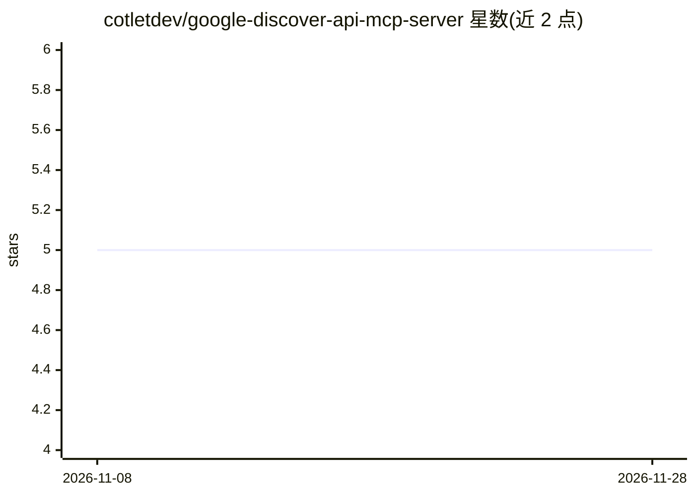

# cotletdev/google-discover-api-mcp-server

⭐ 5 · Python · NOASSERTION · 推送 2026-11-23 · [GitHub](https://github.com/cotletdev/google-discover-api-mcp-server) · [官网](https://cotlet.dev/integrations/google-discover-api-mcp-server) · 个人维护

**让 AI 助手读取 Google Discover 信息流的 MCP 服务器与 API**

用 Python 实现的 Google Discover 读取工具：模拟 Chrome for Android 未登录状态对 discover-pa.googleapis.com 的 protobuf 请求，把任何国家/语言的信息流卡片（位置、标题、发布者、URL、类型、年龄、图片）以 JSON 返回。提供 MCP server（stdio/HTTP）、本地 REST API 与 Python 调用接口，共 3 个只读工具。面向开发者自托管，另提供托管服务 Cotlet 给发布者/SEO 团队。需要下载 Chrome APK 提取 API key；无代理只能读本国的 feed。

## 筛选速览

| 维度 | 判定 | 备注 |
|---|---|---|
| AI 角色 | `ai-ecosystem` | LLM/agent 周边工具 |
| 许可风险 | `none` | NOASSERTION |
| 部署形态 | `library` | 以包/库形式分发 |
| 模型依赖 | — | README 未给出锁定关系 |
| 硬件要求 | — | 无带数字的原话,不猜 |
| 安装摩擦 | `low` | 无编译、无系统依赖或容器化 |
| 成熟度 | — | 结构信号不足 |

## 能力要点

- 提供 MCP server（stdio/HTTP）、REST API 与 Python 三种接入方式
- 无需 Google 账号与浏览器，从 Chrome for Android APK 提取 API key
- 3 个只读工具：读 feed、按域名查卡片、收集批量卡片
- 通过支持 {country} 占位符的代理读取其他国家/地区的 feed

## 适用场景

- 让 Claude/Cursor 等 agent 查询自己的站点是否在 Discover feed 中
- 统计某国家/主题下哪些发布者占据最多卡片位置
- 把 Discover 数据接入自动化工作流做趋势跟踪

## 场景标签

`网页抓取` · 领域:效率与自动化

## 证据(README 行号)

> L37: - **MCP server** for Claude Code, Claude Desktop, Cursor, Codex and any MCP client, over stdio or HTTP. Setup
> L43: Google Discover MCP server
> L91: **Can I watch several countries?**

## 星数曲线

2026-11-08 5 → 2026-11-28 5（+0）

---
*卡片 v1 · prompt 1.4 · 生成 2026-11-21 · 置信度 high · 依据 README sha `6720ab05343b` · [字段定义](../../DATASET.md)*
