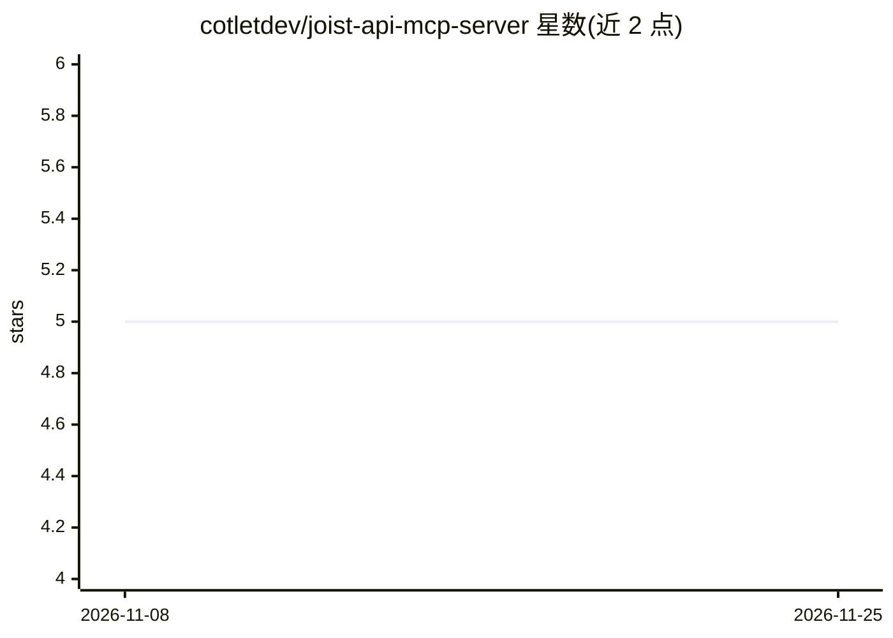

# cotletdev/joist-api-mcp-server

⭐ 5 · Python · NOASSERTION · 推送 2026-11-23 · [GitHub](https://github.com/cotletdev/joist-api-mcp-server) · [官网](https://cotlet.dev/integrations/joist-api-mcp-server) · 组织维护

**把 Joist 接入 ChatGPT/Claude 等 AI 代理的 MCP 服务器与 REST API**

为承包商行业软件 Joist 提供 20 个工具的非官方 API 与 MCP 服务器：AI 代理或脚本可通过它创建客户、撰写报价单、生成发票、记录付款、查询欠款并导出月度 CSV。托管版 Cotlet 面向承包商老板，免安装；本仓库为开发者提供 Python 3.11+ 的自托管版本，通过 Chrome DevTools Protocol 读取本地已登录的 Joist 会话（不存储密码），用 curl_cffi 模拟 Chrome TLS 指纹调用 Joist 网页端点，不运行无头浏览器。许可为 Elastic 2.0。

## 筛选速览

| 维度 | 判定 | 备注 |
|---|---|---|
| AI 角色 | `ai-ecosystem` | LLM/agent 周边工具 |
| 许可风险 | `none` | NOASSERTION |
| 部署形态 | `library` | 以包/库形式分发 |
| 模型依赖 | locked-api |  |
| 硬件要求 | — | 无带数字的原话,不猜 |
| 安装摩擦 | `low` | 无编译、无系统依赖或容器化 |
| 成熟度 | `idea` | |

## 能力要点

- 20 个 Joist 工具，以 MCP（stdio/HTTP）与 REST API（含 OpenAPI 文档）两种形式提供
- 通过 Chrome DevTools Protocol 读取本机 Joist 会话 cookie，不存储密码
- 读操作标记 read-only，发邮件/收款/删除类操作提示客户端先确认
- 附 Python call() 接口与 examples/ 下 9 个现成脚本

## 适用场景

- 让 ChatGPT/Claude 用自然语言在 Joist 中写报价单和发票
- 把 Joist 操作接入 n8n/Make/Zapier 等自动化流程
- 本地脚本批量查询逾期发票并生成催款草稿

## 场景标签

`工作流自动化` · 领域:效率与自动化

## 证据(README 行号)

> L39: - **MCP server** for Claude Code, Claude Desktop, Cursor, Codex and any MCP client, over stdio or HTTP. Setup
> L40: - **REST API** on `http://127.0.0.1:8787/api/v1/joist`, with OpenAPI docs at `/docs`. Setup
> L41: - **Python**: `call("list_invoices", view="overdue")`, plus 9 ready scripts in `examples/`.

## 星数曲线

2026-11-08 5 → 2026-11-25 5（+0）

---
*卡片 v1 · prompt 1.4 · 生成 2026-11-21 · 置信度 high · 依据 README sha `380ef59dcc98` · [字段定义](../../DATASET.md)*
