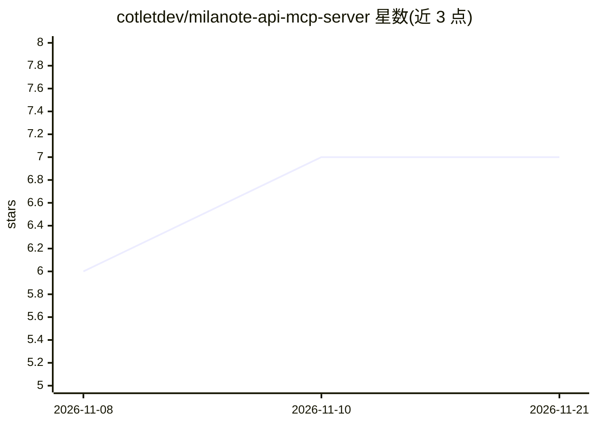

# cotletdev/milanote-api-mcp-server

⭐ 7 · Python · NOASSERTION · 推送 2026-11-10 · [GitHub](https://github.com/cotletdev/milanote-api-mcp-server) · [官网](https://cotlet.dev/integrations/milanote-api-mcp-server) · 组织维护

**让 AI 助手通过 MCP 操作 Milanote 看板的 API/MCP 服务器**

为无公开 API 的 Milanote 提供自托管 API 与 MCP 服务器：通过 Chrome DevTools Protocol 读取用户已登录的 Milanote 会话 cookie，据此调用 Milanote 网页端接口，提供 30 个工具覆盖看板、笔记、链接、待办、导出 Markdown 等操作，以 stdio 或 HTTP 暴露 MCP，另提供本机 REST API（含 OpenAPI 文档）与 Python 调用接口。面向能用终端与 Python 的开发者；同团队另提供免安装的托管服务 Cotlet（7 天免费后按积分付费），需 Python 3.11+ 与 Chrome 144+。

## 筛选速览

| 维度 | 判定 | 备注 |
|---|---|---|
| AI 角色 | `ai-ecosystem` | LLM/agent 周边工具 |
| 许可风险 | `none` | NOASSERTION |
| 部署形态 | `library` | 以包/库形式分发 |
| 模型依赖 | — | README 未给出锁定关系 |
| 硬件要求 | — | 无带数字的原话,不猜 |
| 安装摩擦 | `low` | 无编译、无系统依赖或容器化 |
| 成熟度 | — | 结构信号不足 |

## 能力要点

- 30 个 Milanote 工具以 MCP（stdio/HTTP）与本机 REST API 形式提供
- 通过 Chrome DevTools Protocol 读取已登录会话 cookie，无需密码与 API key
- 支持 Claude Code、Claude Desktop、Cursor、Codex 等 MCP 客户端的配置示例
- 支持 --read-only 模式与按工具标注（读操作标记为只读）

## 适用场景

- 让 Claude 或 Cursor 读写、整理我的 Milanote 看板
- 把 Milanote 看板及其子看板批量导出为 Markdown
- 把会议记录中的行动项以带日期的待办写入看板

## 场景标签

`知识库管理` · 领域:知识与检索

## 证据(README 行号)

> L35: Milanote has no public API and no official MCP server. This repo gives you both:
> L37: - **MCP server** for Claude Code, Claude Desktop, Cursor, Codex and any MCP client, over stdio or HTTP. Setup
> L106: 2. `milanote-mcp connect` attaches to that Chrome through the Chrome DevTools Protocol, reads the milanote.com coo

## 星数曲线

2026-11-08 6 → 2026-11-21 7（+1）

---
*卡片 v1 · prompt 1.4 · 生成 2026-11-21 · 置信度 high · 依据 README sha `d3034fa2370b` · [字段定义](../../DATASET.md)*
