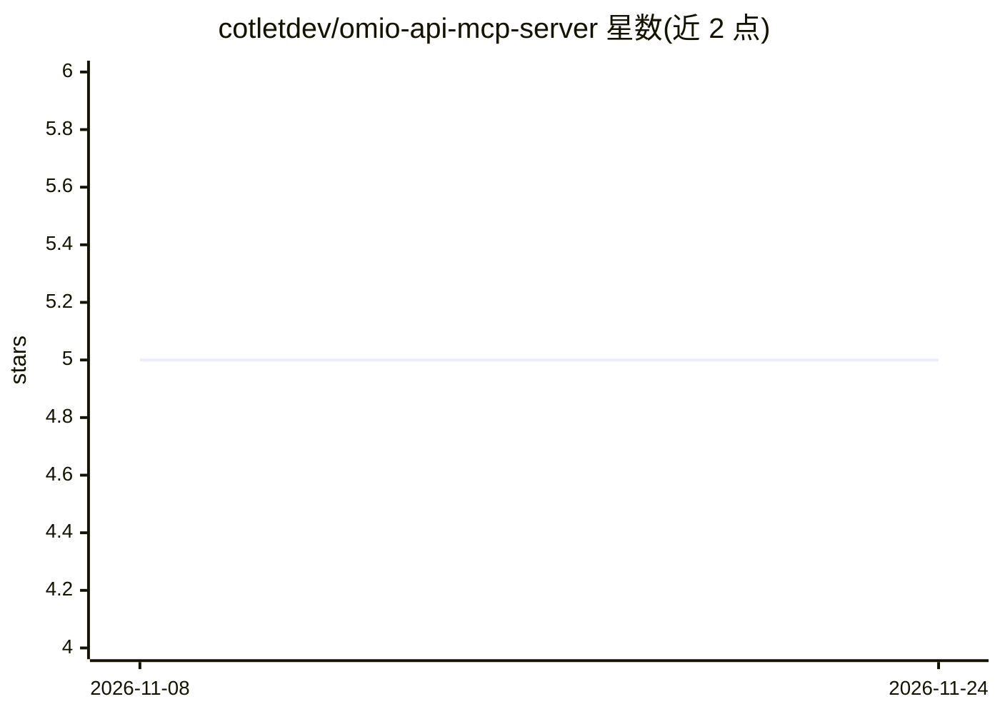

# cotletdev/omio-api-mcp-server

⭐ 5 · Python · NOASSERTION · 推送 2026-11-10 · [GitHub](https://github.com/cotletdev/omio-api-mcp-server) · [官网](https://cotlet.dev/integrations/omio-api-mcp-server) · 组织维护

**把 Omio 账号接入 ChatGPT/Claude 等 AI agent 的 MCP 服务器与 REST API**

在本地运行的 Omio API 封装与 MCP 服务器，提供 16 个工具：地点、火车/巴士/航班/轮渡搜索、最低价日期、票价退改条件、往返查询、预订（止于结账链接）、订单与常用乘客读取。通过 Chrome DevTools Protocol 从本机 Chrome 读取 Omio 会话 cookie，用 curl_cffi 模拟 Chrome TLS 指纹调用 omio.com 网页端接口，不经浏览器自动化，也不代付款。同一维护方另提供托管版 Cotlet（7 天试用后按积分付费）。

## 筛选速览

| 维度 | 判定 | 备注 |
|---|---|---|
| AI 角色 | `ai-ecosystem` | LLM/agent 周边工具 |
| 许可风险 | `none` | NOASSERTION |
| 部署形态 | `library` | 以包/库形式分发 |
| 模型依赖 | — | README 未给出锁定关系 |
| 硬件要求 | — | 无带数字的原话,不猜 |
| 安装摩擦 | `low` | 无编译、无系统依赖或容器化 |
| 成熟度 | — | 结构信号不足 |

## 能力要点

- 16 个 Omio 工具以 MCP（stdio/HTTP）与 REST API（含 OpenAPI 文档）两种形式提供
- 经 Chrome DevTools Protocol 读取本机 Omio 会话 cookie，无需 API key
- 写操作工具标记为需客户端确认，支持 --read-only 只读模式
- Python 调用接口与 examples/ 内 8 个现成脚本

## 适用场景

- 用自然语言让 AI 助手比较火车/巴士/航班并给出结账链接
- 通过 n8n/Make/Zapier 等自动化工具读取 Omio 订单
- 在本地以 Python 脚本查询行程与票价退改条件

## 场景标签

 · 领域:旅行/API 接入

## 证据(README 行号)

> L33: An **Omio API** and an **Omio MCP server** you run on your own computer, in Python, on the session of your own Goog
> L37: - **MCP server** for Claude Code, Claude Desktop, Cursor, Codex and any MCP client, over stdio or HTTP. Setup
> L101: AI agent (MCP) / script (REST, Python) ──▶ omio-mcp on your computer ──your Omio cookies──▶ www.omio.com

## 星数曲线

2026-11-08 5 → 2026-11-24 5（+0）

---
*卡片 v1 · prompt 1.4 · 生成 2026-11-21 · 置信度 high · 依据 README sha `9b79e157cede` · [字段定义](../../DATASET.md)*
