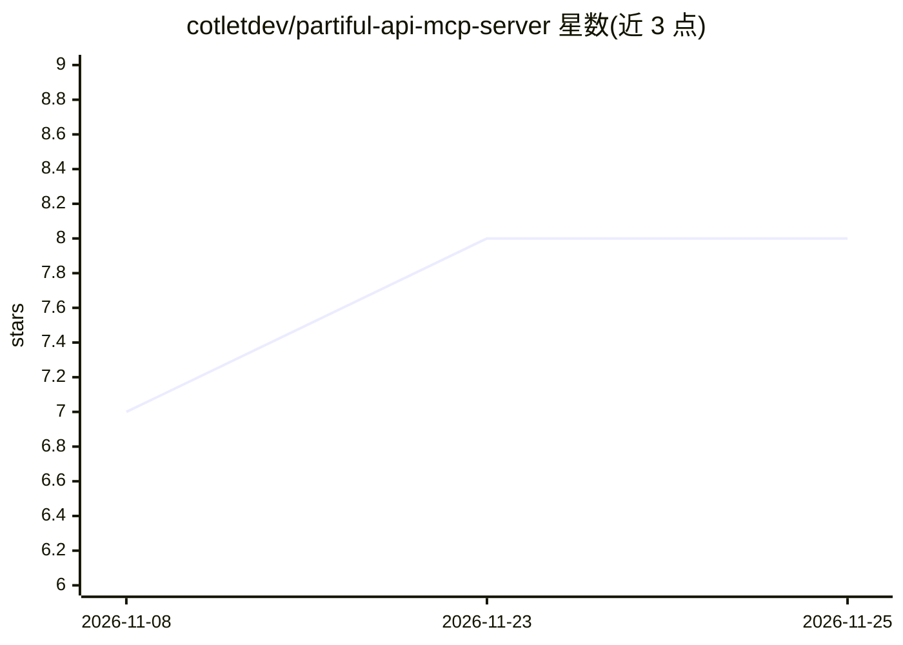

# cotletdev/partiful-api-mcp-server

⭐ 8 · Python · NOASSERTION · 推送 2026-11-23 · [GitHub](https://github.com/cotletdev/partiful-api-mcp-server) · [官网](https://cotlet.dev/integrations/partiful-api-mcp-server) · 组织维护

**让 AI 助手操作 Partiful 的 API 与 MCP 服务器**

为活动平台 Partiful 提供非官方的 API 与 MCP 服务器实现：从本机 Chrome 读取用户已登录的 Partiful 会话，经 DevTools Protocol 获取 cookies 与 IndexedDB 中的登录信息，再调用 Partiful 网页应用自身使用的端点。提供 14 个工具，覆盖活动创建、宾客名单与问卷答案、RSVP 读取、签到、宾客审批、邀请与群发短信；支持 stdio 或 HTTP 方式接入 MCP 客户端，另提供本地 REST API（含 OpenAPI 文档）与 Python 调用接口及示例脚本。同作者还提供托管版本 Cotlet（7 天免费，之后按次付费）。运行依赖 Python 3.11+ 与 Chrome 144+。

## 筛选速览

| 维度 | 判定 | 备注 |
|---|---|---|
| AI 角色 | `ai-ecosystem` | LLM/agent 周边工具 |
| 许可风险 | `none` | NOASSERTION |
| 部署形态 | `library` | 以包/库形式分发 |
| 模型依赖 | — | README 未给出锁定关系 |
| 硬件要求 | — | 无带数字的原话,不猜 |
| 安装摩擦 | `low` | 无编译、无系统依赖或容器化 |
| 成熟度 | — | 结构信号不足 |

## 能力要点

- 14 个 Partiful 工具：活动、宾客名单、RSVP、签到、审批、邀请与 Text Blasts
- MCP 服务器支持 stdio 与 HTTP，接入 Claude Code、Claude Desktop、Cursor、Codex 等客户端
- 通过 Chrome DevTools Protocol 复用用户自己的登录会话，不存储密码
- 本地 REST API（127.0.0.1:8787）附 OpenAPI 文档与 Python 调用方式、示例脚本

## 适用场景

- 用自然语言让 AI 助手查询活动宾客的 RSVP 与问卷答案
- 让 AI 代理代为审批宾客、复制过往活动并邀请参与者
- 本地脚本或 n8n 等自动化流程读取宾客名单并导出数据

## 场景标签

`工作流自动化` · 领域:效率与自动化

## 证据(README 行号)

> L33: A **Partiful API** and a **Partiful MCP server** you run on your own computer, in Python, on the session of your ow
> L35: Partiful has no public API and no official MCP server. This repo gives you both:
> L37: - **MCP server** for Claude Code, Claude Desktop, Cursor, Codex and any MCP client, over stdio or HTTP. Setup

## 星数曲线

2026-11-08 7 → 2026-11-25 8（+1）

---
*卡片 v1 · prompt 1.4 · 生成 2026-11-20 · 置信度 high · 依据 README sha `768a641ec526` · [字段定义](../../DATASET.md)*
