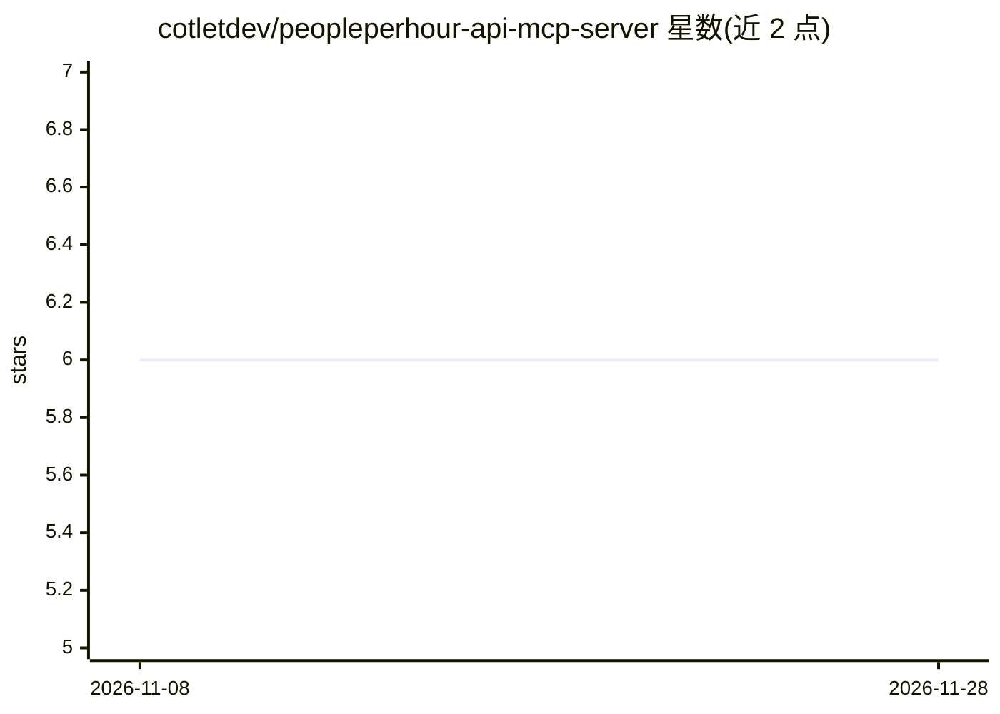

# cotletdev/peopleperhour-api-mcp-server

⭐ 6 · Python · NOASSERTION · 推送 2026-11-23 · [GitHub](https://github.com/cotletdev/peopleperhour-api-mcp-server) · [官网](https://cotlet.dev/integrations/peopleperhour-api-mcp-server) · 组织维护

**把 PeoplePerHour 接入 ChatGPT/Claude 等 AI 客户端的 MCP 服务器与 REST API**

围绕 PeoplePerHour（无公开 API）构建的非官方接口层：通过 Chrome DevTools Protocol 读取用户已登录会话的 cookies，用 curl_cffi 复制 Chrome TLS 指纹调用网站自身的 JSON API，向外提供 17 个工具，以 MCP server（stdio/HTTP）与本地 REST API（含 OpenAPI 文档）两种形式交付；13 个只读工具用于搜索项目、读 brief、查自由职业者与评价，4 个工具仅修改自己的关注列表与保存的搜索。任何会触达他人的操作（发提案、发消息）均不提供。同团队另提供托管版 Cotlet。

## 筛选速览

| 维度 | 判定 | 备注 |
|---|---|---|
| AI 角色 | `ai-ecosystem` | LLM/agent 周边工具 |
| 许可风险 | `none` | NOASSERTION |
| 部署形态 | `library` | 以包/库形式分发 |
| 模型依赖 | — | README 未给出锁定关系 |
| 硬件要求 | — | 无带数字的原话,不猜 |
| 安装摩擦 | `low` | 无编译、无系统依赖或容器化 |
| 成熟度 | — | 结构信号不足 |

## 能力要点

- 17 个 PeoplePerHour 工具，以 MCP server（stdio/HTTP）和 REST API 交付
- 通过 Chrome DevTools Protocol 读取登录 cookies，不存储密码
- curl_cffi 复制 Chrome TLS 指纹调用站点内部 JSON API，无 headless 浏览器
- 13 个只读工具，--read-only 可隐藏 4 个写入型工具

## 适用场景

- 让 Claude Code/Cursor 自动搜索新项目并起草提案草稿
- 为自由职业者保存搜索并通过邮件提醒获取新项目清单
- 用 Python 脚本或 n8n/Make/Zapier（经托管版）批量查询项目与自由职业者信息

## 场景标签

`网页抓取` · 领域:效率与自动化

## 证据(README 行号)

> L35: A **PeoplePerHour API** and a **PeoplePerHour MCP server** you run on your own computer, in Python, on the session 
> L37: PeoplePerHour has no public API and no official MCP server. This repo gives you both:
> L39: - **MCP server** for Claude Code, Claude Desktop, Cursor, Codex and any MCP client, over stdio or HTTP. Setup

## 星数曲线

2026-11-08 6 → 2026-11-28 6（+0）

---
*卡片 v1 · prompt 1.4 · 生成 2026-11-21 · 置信度 high · 依据 README sha `b66c2459b54b` · [字段定义](../../DATASET.md)*
