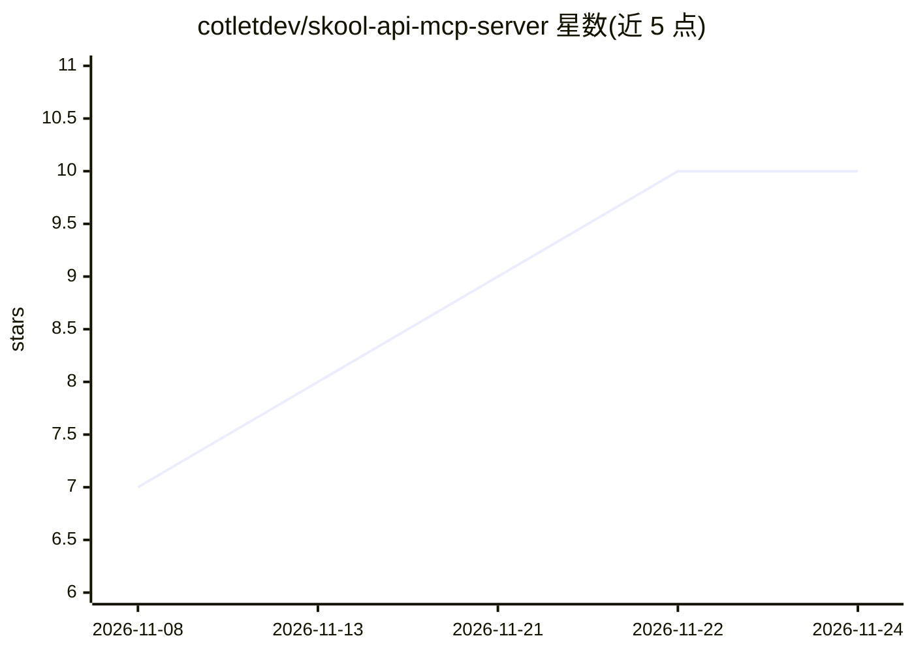

# cotletdev/skool-api-mcp-server

⭐ 10 · Python · NOASSERTION · 推送 2026-11-10 · [GitHub](https://github.com/cotletdev/skool-api-mcp-server) · [官网](https://cotlet.dev/integrations/skool-api-mcp-server) · 组织维护

**把 Skool 社区接入 MCP 客户端与 AI 代理的 API 服务器**

本仓库提供在本地 Python 环境运行的 Skool API 与 MCP server，共 71 个工具，覆盖成员、入会申请、帖子、评论、Classroom、视频转录、Calendar、群设置与统计数据。它通过 Chrome DevTools Protocol 读取用户自己浏览器的 Skool 会话 cookie，再用 curl_cffi 模拟 Chrome TLS 指纹请求 Skool 网页端点；提供 stdio/HTTP 两种 MCP 接入和本地 REST API（含 OpenAPI 文档），支持 Claude Code、Claude Desktop、Cursor、Codex 等客户端。需要 Python 3.11+、Chrome 144+，同一团队另提供托管付费版本 Cotlet。

## 筛选速览

| 维度 | 判定 | 备注 |
|---|---|---|
| AI 角色 | `ai-ecosystem` | LLM/agent 周边工具 |
| 许可风险 | `none` | NOASSERTION |
| 部署形态 | `library` | 以包/库形式分发 |
| 模型依赖 | — | README 未给出锁定关系 |
| 硬件要求 | — | 无带数字的原话,不猜 |
| 安装摩擦 | `low` | 无编译、无系统依赖或容器化 |
| 成熟度 | — | 结构信号不足 |

## 能力要点

- 71 个 Skool 工具，含 MCP server 与本地 REST API（OpenAPI 文档）
- 通过 Chrome DevTools Protocol 读取自身浏览器会话，不存储密码
- 支持 stdio 与 streamable HTTP 两种 MCP 传输方式
- 写操作工具带标记，客户端可先询问再执行

## 适用场景

- 用自然语言让 AI 代理审批入会申请、回复帖子、建 Calendar 事件
- 通过 REST API 或 Python 脚本导出成员列表与统计数据
- 在 n8n、Make、Zapier 自动化流程中操作 Skool 社区

## 场景标签

 · 领域:社区运营工具/AI 代理接入

## 证据(README 行号)

> L33: A **Skool API** and a **Skool MCP server** you run on your own computer, in Python, on the session of your own Goog
> L37: - **MCP server** for Claude Code, Claude Desktop, Cursor, Codex and any MCP client, over stdio or HTTP. Setup
> L44: Python 3.11+

## 星数曲线

2026-11-08 7 → 2026-11-24 10（+3）

---
*卡片 v1 · prompt 1.4 · 生成 2026-11-20 · 置信度 high · 依据 README sha `ea13d8a10e30` · [字段定义](../../DATASET.md)*
