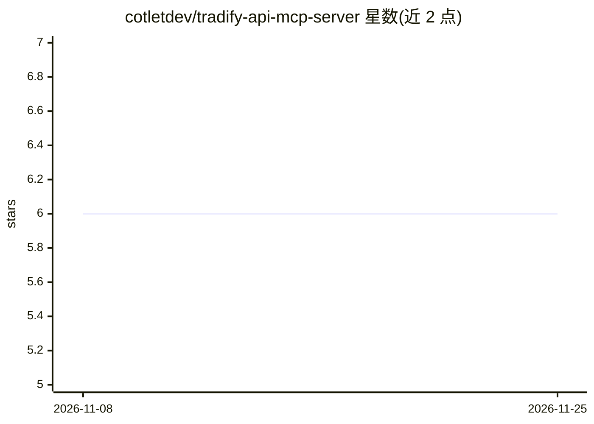

# cotletdev/tradify-api-mcp-server

⭐ 6 · Python · NOASSERTION · 推送 2026-11-23 · [GitHub](https://github.com/cotletdev/tradify-api-mcp-server) · [官网](https://cotlet.dev/integrations/tradify-api-mcp-server) · 组织维护

**给现场服务企业用户：让 AI agent 操作 Tradify 的 API 与 MCP 服务器**

为无公开 API 的 Tradify 提供非官方 API 与 MCP 服务器：基于 Chrome DevTools Protocol 读取用户已登录的 Tradify 会话 cookie，以 curl_cffi 模拟 Chrome TLS 指纹调用 Tradify Web 应用自身使用的接口，暴露 22 个工具（jobs、customers、quotes、invoices、payments、Scheduler、报表、工时），形式为 stdio/HTTP 的 MCP 服务器、本地 REST API 与 Python 调用接口。面向两类用户：托管服务 Cotlet 面向行业企业主；本仓库面向能使用 Python 与终端的开发者/自托管者。发送报价/发票邮件需 Tradify 账号开启 2-Step Security。

## 筛选速览

| 维度 | 判定 | 备注 |
|---|---|---|
| AI 角色 | `ai-ecosystem` | LLM/agent 周边工具 |
| 许可风险 | `none` | NOASSERTION |
| 部署形态 | `library` | 以包/库形式分发 |
| 模型依赖 | — | README 未给出锁定关系 |
| 硬件要求 | — | 无带数字的原话,不猜 |
| 安装摩擦 | `low` | 无编译、无系统依赖或容器化 |
| 成熟度 | — | 结构信号不足 |

## 能力要点

- 22 个 Tradify 工具，以 MCP 服务器（stdio/HTTP）、REST API 与 Python 接口三种形式提供
- 通过 Chrome DevTools Protocol 读取已登录会话 cookie，不存储密码与 2-Step 代码
- 含发送确认机制的写操作：发客户前需用户确认
- 支持 Claude Code、Claude Desktop、Cursor、Codex 及任意 MCP 客户端接入

## 适用场景

- 用自然语言让 AI 创建工单、写报价、开发票、记录收款
- 把本周已接受的报价批量转为定金发票
- 查询逾期发票并按客户汇总
- 在本地 REST API 上编写脚本操作 Tradify 数据

## 场景标签

 · 领域:企业软件集成/AI agent 工具

## 证据(README 行号)

> L41: - **MCP server** for Claude Code, Claude Desktop, Cursor, Codex and any MCP client, over stdio or HTTP. Setup
> L108: AI agent (MCP) / script (REST, Python) ──▶ tradify-mcp on your computer ──your cookies──▶ go.tradifyhq.com

## 星数曲线

2026-11-08 6 → 2026-11-25 6（+0）

---
*卡片 v1 · prompt 1.4 · 生成 2026-11-20 · 置信度 high · 依据 README sha `44e13aa73042` · [字段定义](../../DATASET.md)*
