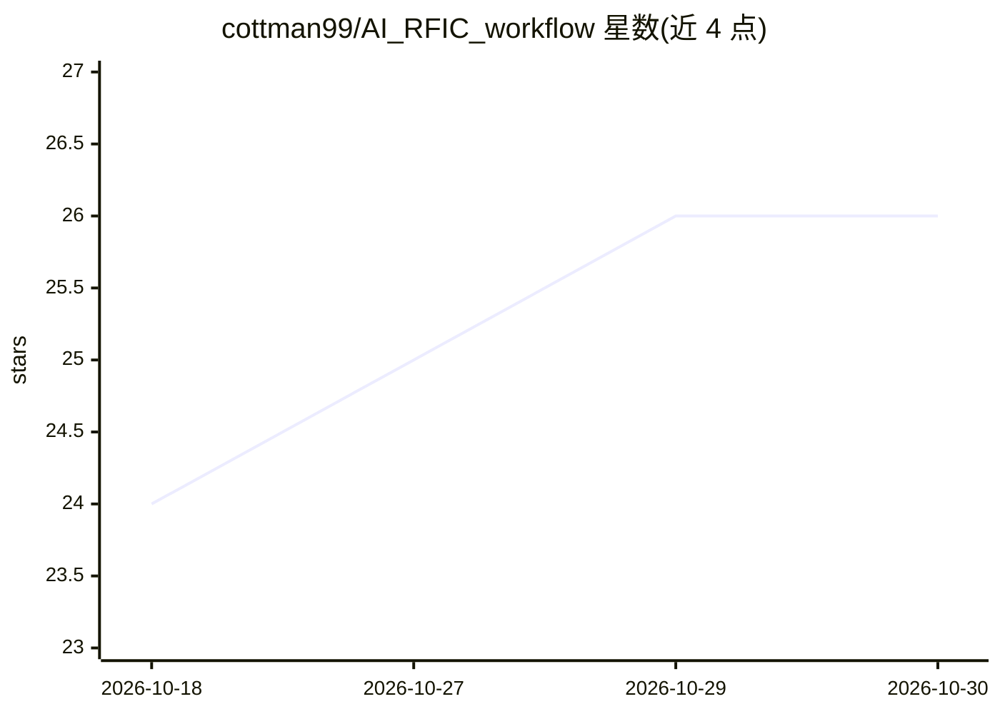

# cottman99/AI_RFIC_workflow

⭐ 26 · Python · NOASSERTION · 推送 2026-03-10 · [GitHub](https://github.com/cottman99/AI_RFIC_workflow) · 个人维护

**基于 Keysight ADS/RFPro 的 RFIC 版图自动化与 CNN 代理建模研究工作流**

面向射频集成电路研究的端到端工作流：生成/编辑像素化版图 JSON 模板（多层像素矩阵、端口放置、批量随机变体），通过 ADS/RFPro 自动化创建工作区并运行电磁仿真导出 Touchstone/CSV 数据，将版图与仿真结果转为 HDF5 数据集，最终训练 PyTorch CNN 代理模型从版图张量直接预测电磁响应。采用双 Python 环境运行时（外部编排层 + ADS 内置 Python），端到端执行需 Windows、Keysight ADS/RFPro 许可与 PDK。作者声明其为研究工作流而非成熟产品，主流程已于 2026 年 3 月通过运行验证。

## 筛选速览

| 维度 | 判定 | 备注 |
|---|---|---|
| AI 角色 | `ai-native` | 本体是模型或模型工具 |
| 许可风险 | `none` | NOASSERTION |
| 部署形态 | `desktop` | 安装包/桌面程序 |
| 模型依赖 | — | README 未给出锁定关系 |
| 硬件要求 | — | 无带数字的原话,不猜 |
| 安装摩擦 | `low` | 无编译、无系统依赖或容器化 |
| 成熟度 | `idea` | |

## 能力要点

- 像素化 RFIC 版图 JSON 生成与批量随机变体工具
- ADS/RFPro 电磁仿真自动化，导出 Touchstone/CSV/ADS 数据集
- 版图与电磁结果转 HDF5 数据集并训练 PyTorch CNN 代理模型
- 双 Python 运行时模型：编排环境与 HDF5/ML 环境分离

## 适用场景

- 我要批量生成 RFIC 版图样本并自动跑电磁仿真构建数据集
- 我想训练 CNN 代理模型从版图直接预测电磁响应以减少仿真次数
- 我在 Keysight ADS/RFPro 环境下做 RFIC 研究的自动化流水线搭建

## 场景标签

`工作流自动化` `科研工具` · 领域:效率与自动化

## 证据(README 行号)

> L11: 5. train a PyTorch CNN surrogate model that predicts EM responses directly from layout tensors
> L139: - end-to-end execution requires Windows, Keysight ADS / RFPro, valid licenses, and an accessible PDK or reference 

## 星数曲线

2026-10-18 24 → 2026-10-30 26（+2）

---
*卡片 v1 · prompt 1.4 · 生成 2026-10-27 · 置信度 mid · 依据 README sha `1ac2c4df98d6` · [字段定义](../../DATASET.md)*
