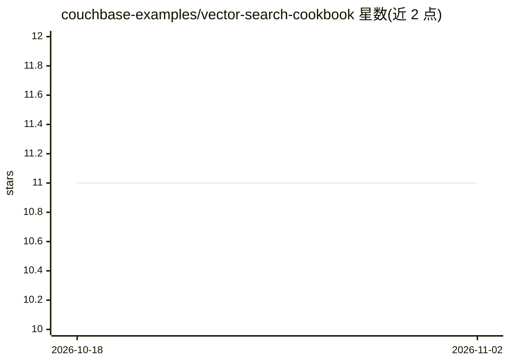

# couchbase-examples/vector-search-cookbook

⭐ 11 · Jupyter Notebook · MIT · 推送 2026-07-24 · [GitHub](https://github.com/couchbase-examples/vector-search-cookbook) · [官网](https://developer.couchbase.com/tutorials/) · 组织维护

**Couchbase 向量搜索示例集：多厂商嵌入模型+LLM 的语义搜索/RAG 配方**

Couchbase 官方示例仓库，演示以 Couchbase 为后端数据库构建语义搜索引擎：每个示例提供两条路径——基于预建索引的 Search Vector Index，以及用 SQL++ 向量相似度函数的 Hyperscale/Composite Vector Index。嵌入模型覆盖 OpenAI、Azure OpenAI、Anthropic、Cohere、Hugging Face、Jina AI、Mistral AI、Voyage AI 八家，另含 RAG 管线（GPT-4 类模型）与 CouchbaseCache 缓存机制。面向需要在 Couchbase 上接入向量检索与 RAG 的开发者，以 Jupyter notebook 形式提供，可在 Google Colab 或本地 Python 环境运行；需自备 Couchbase 7.6+ 集群（含 Search Service）与各 AI 厂商 API key。

## 筛选速览

| 维度 | 判定 | 备注 |
|---|---|---|
| AI 角色 | `ai-ecosystem` | LLM/agent 周边工具 |
| 许可风险 | `permissive` | MIT |
| 部署形态 | `None` |  |
| 模型依赖 | locked-api |  |
| 硬件要求 | — | 无带数字的原话,不猜 |
| 安装摩擦 | `low` | 无编译、无系统依赖或容器化 |
| 成熟度 | — | 结构信号不足 |

## 能力要点

- 8 家嵌入模型厂商的接入示例（OpenAI/Azure/Anthropic/Cohere/Hugging Face/Jina/Mistral/Voyage）
- 两种索引路径：Search Vector Index 与 SQL++ 向量相似度函数（Hyperscale/Composite）
- RAG 管线集成 GPT-4 类语言模型生成回答
- CouchbaseCache 缓存机制提升重复查询性能

## 适用场景

- 在 Couchbase 集群上搭建语义搜索或 RAG 应用的参考实现
- 对比不同厂商嵌入模型在向量检索中的用法
- 学习 Couchbase 向量索引的两种创建方式

## 场景标签

`RAG` `语义搜索` · 领域:知识与检索

## 证据(README 行号)

> L3: This repository demonstrates how to build a powerful semantic search engine using Couchbase as the backend database,
> L13: - **Multiple Embedding Models**: Support for embeddings from OpenAI, Azure OpenAI, Anthropic (Claude), Cohere, Hugg
> L67: The RAG pipeline integrates with language models like GPT-4 to generate contextually relevant answers based on retr

## 星数曲线

2026-10-18 11 → 2026-11-02 11（+0）

---
*卡片 v1 · prompt 1.4 · 生成 2026-11-02 · 置信度 high · 依据 README sha `f628c65dbe07` · [字段定义](../../DATASET.md)*
