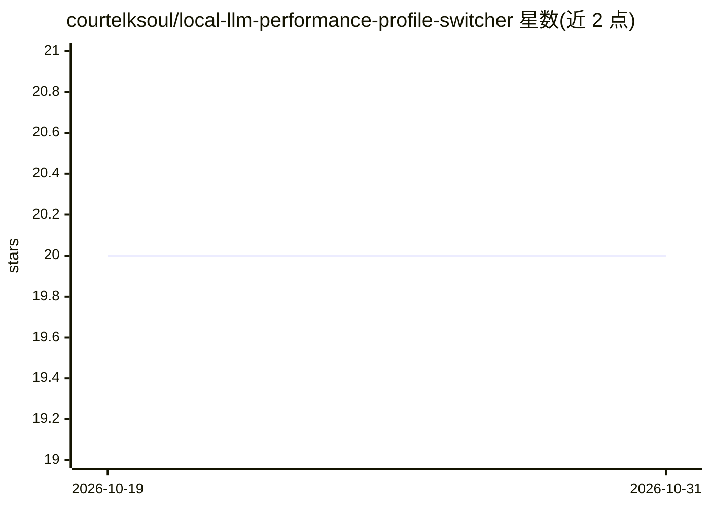

# courtelksoul/local-llm-performance-profile-switcher

⭐ 20 · CSS · MIT · 推送 2026-10-19 · [GitHub](https://github.com/courtelksoul/local-llm-performance-profile-switcher) · 个人维护

**Windows 本地 LLM 性能配置文件切换与恢复工具**

面向本地 AI 工作流的 Windows 实用程序：围绕 LLM 性能配置文件、生成速度对比与低显存配置组织工作流，提供配置备份、可复用备选配置与回滚恢复步骤。使用方式为下载 ZIP 压缩包、解压后运行 exe；包含选择/检测模型与运行时环境、分析当前配置、保存/应用配置、验证重启运行时、恢复已知良好配置的流程。README 声明为独立工具，不隶属于 Ollama、NVIDIA、AMD 等厂商，仓库不含商业模型。

## 筛选速览

| 维度 | 判定 | 备注 |
|---|---|---|
| AI 角色 | `ai-ecosystem` | LLM/agent 周边工具 |
| 许可风险 | `permissive` | MIT |
| 部署形态 | `desktop` | 安装包/桌面程序 |
| 模型依赖 | — | README 未给出锁定关系 |
| 硬件要求 | — | 无带数字的原话,不猜 |
| 安装摩擦 | `low` | 无编译、无系统依赖或容器化 |
| 成熟度 | — | 结构信号不足 |

## 能力要点

- 性能配置文件管理与低显存配置支持
- 生成速度前后对比检查
- 备份优先的配置变更与恢复回滚工作流

## 适用场景

- 为本地 LLM 运行时切换性能或低显存配置
- 调整配置前保存已知良好状态以便回滚
- 对比配置变更前后的生成速度

## 场景标签

 · 领域:本地 AI 工具/性能优化

## 证据(README 行号)

> L19: **Local LLM Performance Profile Switcher** is designed to organize a Windows workflow around **llm performance prof
> L43: 1. **Select / Detect** — choose the relevant model, runtime, GPU, API, or storage context.

## 星数曲线

2026-10-19 20 → 2026-10-31 20（+0）

---
*卡片 v1 · prompt 1.4 · 生成 2026-10-28 · 置信度 mid · 依据 README sha `2344286f1b95` · [字段定义](../../DATASET.md)*
