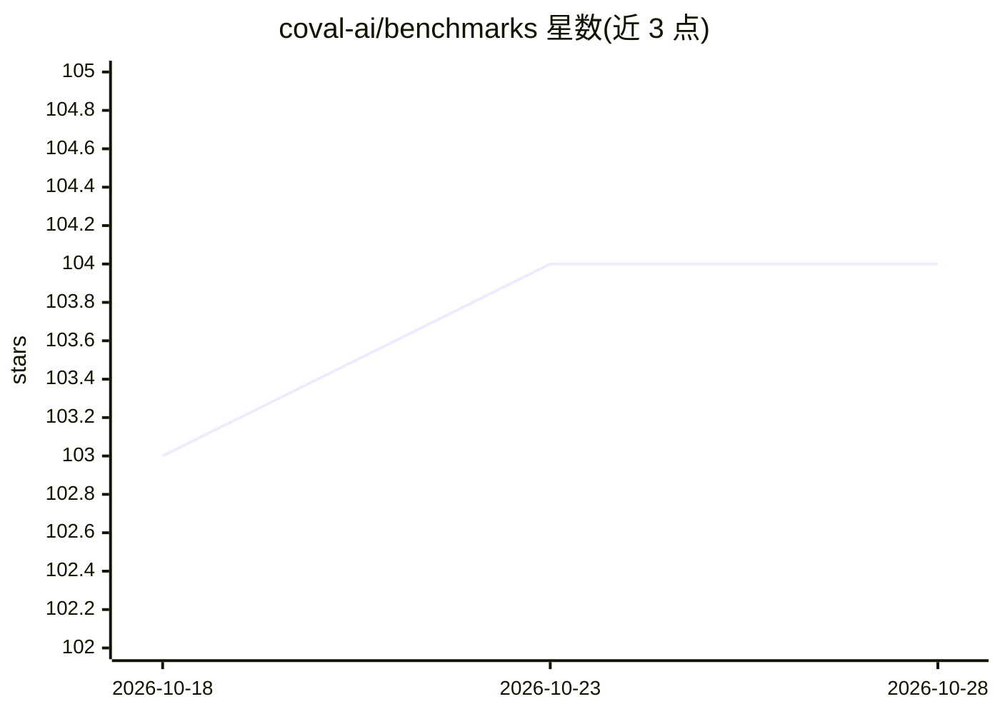

# coval-ai/benchmarks

⭐ 104 · Python · NOASSERTION · 推送 2026-10-28 · [GitHub](https://github.com/coval-ai/benchmarks) · [官网](https://benchmarks.coval.ai) · 组织维护

**语音 AI 模型的持续基准测试框架：TTS/STT/S2S 延迟与准确率**

Coval 维护的开源基准项目：每 30 分钟对近 40 家语音厂商的 TTS、STT、Speech-to-Speech 模型在贴近真实通话的音频条件下（口音、噪声、混响、远场、削波、电话压缩）持续测量 WER、首音频延迟、实时率等指标，并用 Bradley-Terry/Davidson 模型聚合盲测投票。音频文件固定 SHA-256 哈希，全流程可自带 API key 复现；提供 docker compose 拉起 Postgres、FastAPI 与 runner 的完整栈。站上数据即本仓库产出。

## 筛选速览

| 维度 | 判定 | 备注 |
|---|---|---|
| AI 角色 | `ai-ecosystem` | LLM/agent 周边工具 |
| 许可风险 | `permissive` | NOASSERTION |
| 部署形态 | `self-host` | docker 或自建部署 |
| 模型依赖 | — | README 未给出锁定关系 |
| 硬件要求 | — | 无带数字的原话,不猜 |
| 安装摩擦 | `low` | 无编译、无系统依赖或容器化 |
| 成熟度 | — | 结构信号不足 |

## 能力要点

- 每 30 分钟对近 40 家语音厂商持续运行基准
- 8 类贴近真实通话的音频退化条件测试（口音/噪声/混响/电话压缩等）
- 音频按 SHA-256 哈希固定，未变更哈希则 runner 拒绝评分
- 盲测 A/B 投票 + Davidson 模型与 bootstrap 置信区间的 Voice Arena

## 适用场景

- 为语音 agent 选型时比较各 STT/TTS 厂商的延迟与准确率
- 自带 API key 复现榜单数字以验证结果
- 在真实通话类音频条件下评估语音模型的鲁棒性

## 场景标签

`模型评测` · 领域:评测与运维

## 证据(README 行号)

> L5: **Open-source, continuously running benchmarks for speech-to-text, text-to-speech, and speech-to-speech models.**
> L16: Every number on the site comes from this repository. You can rerun it with your own API keys.
> L100:                    Postgres ──▶ FastAPI (/v1/leaderboard, /v1/results, …) ──▶ benchmarks.coval.ai

## 星数曲线

2026-10-18 103 → 2026-10-28 104（+1）

---
*卡片 v1 · prompt 1.4 · 生成 2026-10-23 · 置信度 high · 依据 README sha `fb551621b8f3` · [字段定义](../../DATASET.md)*
