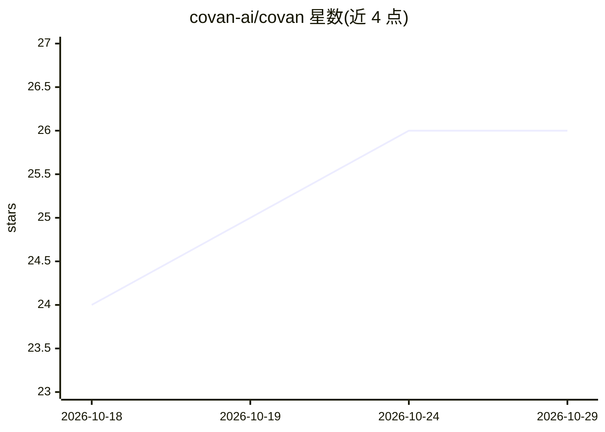

# covan-ai/covan

⭐ 26 · TypeScript · NOASSERTION · 推送 2026-10-27 · [GitHub](https://github.com/covan-ai/covan) · [官网](https://covan.app) · 组织维护

**团队共享知识库的 AI agent：全队共同训练，人人私聊使用**

自托管（FSL-1.1-ALv2 源可得许可）的团队 AI agent 应用：成员上传流程文档、合同、研究资料等形成 agent 共享记忆，每人通过默认私密会话与同一 agent 对话。回答基于 pgvector 相似度检索加 Postgres 全文检索并标注来源文件；支持知识分束、Notion/Drive 同步、Whisper 听写、Slack 提问，以及经 Composio 接入约 1,500 个应用执行操作（需人工批准）。工具循环受步数/令牌/超时限制，授权由 Postgres 行级安全执行。需 Docker 与 OpenAI API key。项目自述年轻、API 未版本化。

## 筛选速览

| 维度 | 判定 | 备注 |
|---|---|---|
| AI 角色 | `ai-native` | 本体是模型或模型工具 |
| 许可风险 | `none` | NOASSERTION |
| 部署形态 | `self-host` | docker 或自建部署 |
| 模型依赖 | — | README 未给出锁定关系 |
| 硬件要求 | — | 无带数字的原话,不猜 |
| 安装摩擦 | `low` | 无编译、无系统依赖或容器化 |
| 成熟度 | `idea` | |

## 能力要点

- 共享知识 + 私人会话：agent 记忆共享，对话彼此隔离
- 回答携带来源引用，带相似度下限的混合检索（pgvector + 全文）
- 经 Composio 接入约 1,500 个应用，操作需人工批准且受步数/令牌预算约束
- 授权在 Postgres RLS 中执行，工具调用按会话记录并可导出

## 适用场景

- 小团队把内部文档变成一个可提问的共享知识 agent
- 让 agent 在批准下执行连接应用的操作（邮件、Notion、数据库只读查询）
- 定时或事件触发（cron、Slack、GitHub、日历）自动运行任务

## 场景标签

`文档问答` `知识库管理` · 领域:知识与检索

## 证据(README 行号)

> L5: One agent your whole team teaches, and a chat with it that belongs to each
> L24: knows — process docs, contracts, research — and that becomes one agent's memory.
> L31:  One `docker compose up` and one API key, and the only interface is a web app.

## 星数曲线

2026-10-18 24 → 2026-10-29 26（+2）

---
*卡片 v1 · prompt 1.4 · 生成 2026-10-26 · 置信度 high · 依据 README sha `743cf70785df` · [字段定义](../../DATASET.md)*
