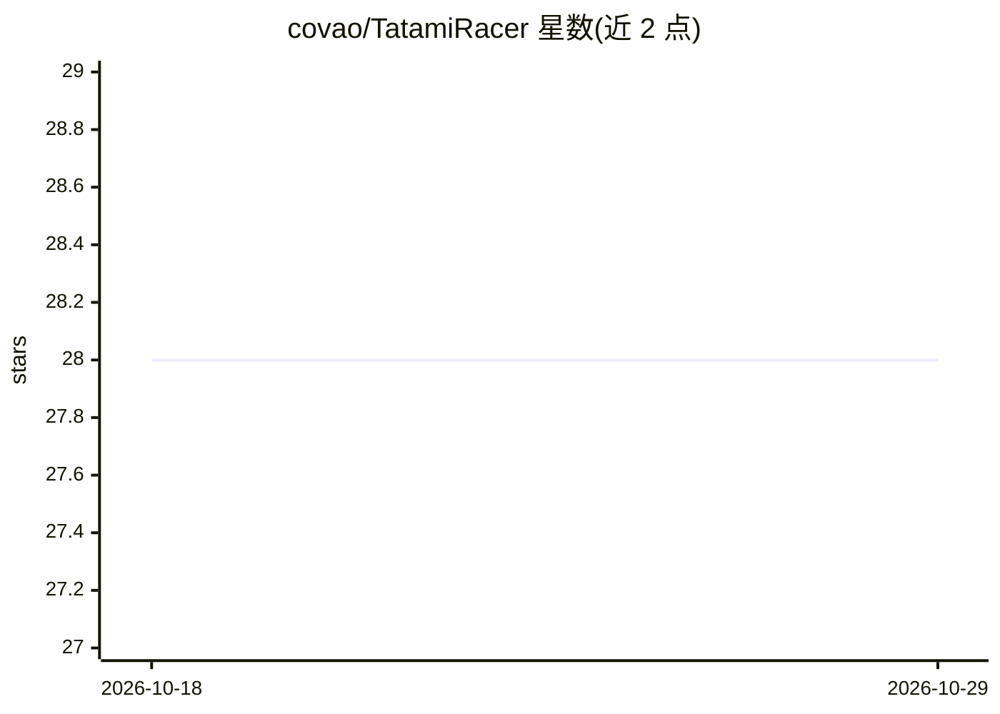

# covao/TatamiRacer

⭐ 28 · Python · MIT · 推送 2026-03-20 · [GitHub](https://github.com/covao/TatamiRacer) · [官网](https://github.com/covao/TatamiRacer) · 个人维护

**基于田宫迷你四驱套件的迷你自动驾驶小车硬件项目**

以 TAMIYA MINI 4WD 套件为底盘的微型自动驾驶小车项目，可在一张榻榻米（约1.8m×0.9m）范围内行驶。软件采用 Donkey Car 实现深度学习与自动驾驶控制。硬件部分需自行组装：树莓派 Zero 2 W 或树莓派 4、摄像头模块、电机驱动、舵机、3D 打印件与移动电源等，最低配置约 6,000 日元（不含树莓派与 SD 卡）。提供 BOM 清单、电路图、组装说明、软件设置、校准与驾驶教程链接，并提供赛道图案布料印刷数据。获 OSHWA 开源硬件认证。

## 筛选速览

| 维度 | 判定 | 备注 |
|---|---|---|
| AI 角色 | `ai-native` | 本体是模型或模型工具 |
| 许可风险 | `permissive` | MIT |
| 部署形态 | `None` |  |
| 模型依赖 | — | README 未给出锁定关系 |
| 硬件要求 | — | 无带数字的原话,不猜 |
| 安装摩擦 | `low` | 无编译、无系统依赖或容器化 |
| 成熟度 | — | 结构信号不足 |

## 能力要点

- 基于 TAMIYA Mini 4WD 套件、可在一张榻榻米内运行的自动驾驶小车
- 使用 Donkey Car 软件进行深度学习与自动驾驶控制
- 提供完整 BOM 清单、3D 打印件、组装与软件设置说明
- ver 2.0 支持安装 Raspberry Pi Zero 2 并更新了 3D 零件

## 适用场景

- 在桌面/榻榻米大小的场地学习自动驾驶小车搭建
- 使用 Donkey Car 框架做深度学习驾驶实验
- 作为教育或创客项目动手组装迷你四驱自动驾驶车

## 场景标签

`教程课程` · 领域:学习与行业

## 证据(README 行号)

> L7: TatamiRacer is a tiny autonomous driving car based on the "TAMIYA MINI 4WD" kit. It can operate within the space of 
> L20: - Supports installation of Raspberry Pi Zero 2

## 星数曲线

2026-10-18 28 → 2026-10-29 28（+0）

---
*卡片 v1 · prompt 1.4 · 生成 2026-10-26 · 置信度 high · 依据 README sha `cdac5fd3bcdd` · [字段定义](../../DATASET.md)*
