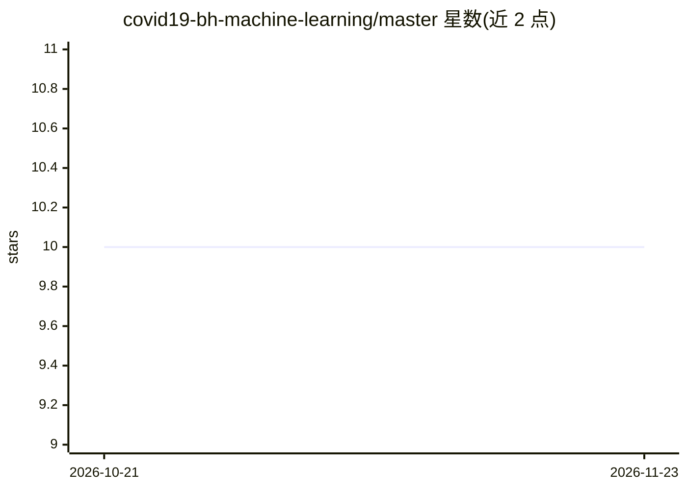

# covid19-bh-machine-learning/master

⭐ 10 · Jupyter Notebook · MIT · 推送 2026-11-14 · [GitHub](https://github.com/covid19-bh-machine-learning/master) · 组织维护

**COVID-19 机器学习项目总览仓库**

该仓库是 covid19-bh-machine-learning 项目的 master/总览仓库，README 仅给出机器学习项目及各子任务（sub-tasks）的概述，并链接到 #Phylogeny 主题产出的进化树。README 内容极简（4 行），未提供安装方式、运行说明、模型或数据集描述。具体能力与用途需查看其子任务仓库。

## 筛选速览

| 维度 | 判定 | 备注 |
|---|---|---|
| AI 角色 | `ai-knowledge` | 知识聚合/清单类 |
| 许可风险 | `permissive` | MIT |
| 部署形态 | `None` |  |
| 模型依赖 | — | README 未给出锁定关系 |
| 硬件要求 | — | 无带数字的原话,不猜 |
| 安装摩擦 | `low` | 无编译、无系统依赖或容器化 |
| 成熟度 | — | 结构信号不足 |

## 能力要点

- 汇总机器学习项目各子任务
- 链接 #Phylogeny 主题产出的进化树

## 适用场景

- 了解该 COVID-19 生物信息协作项目的子任务结构
- 查找进化树分析结果的入口链接

## 场景标签

 · 领域:生命科学/机器学习

## 证据(README 行号)

> L2: Overview of the Machine Learning project and various sub-tasks.
> L4: Link to the tree produced by the #Phylogeny topic

## 星数曲线

2026-10-21 10 → 2026-11-23 10（+0）

---
*卡片 v1 · prompt 1.4 · 生成 2026-11-19 · 置信度 low · 依据 README sha `0dac815ad757` · [字段定义](../../DATASET.md)*
