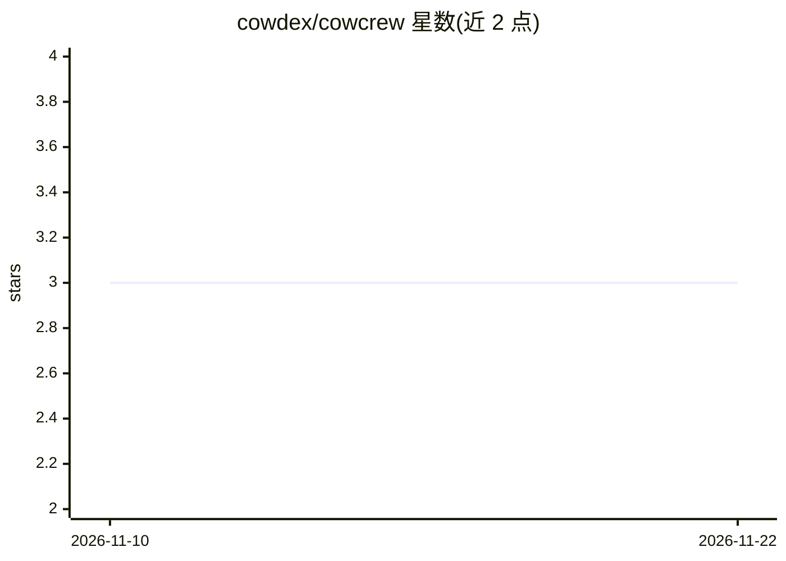

# cowdex/cowcrew

⭐ 3 · Python · Apache-2.0 · 推送 2026-11-09 · [GitHub](https://github.com/cowdex/cowcrew) · [官网](https://github.com/cowdex/cowcrew#quick-start) · 个人维护

**面向开发者的 5-agent AI 软件工厂：从规格到可合并 PR**

在本机运行的 AI 软件工厂：用户提交功能规格后，五个基于 Claude Agent SDK 的 agent（规划、编码、测试、评审、CI 修复）在独立 git worktree 中完成计划、逐任务构建、对抗测试、PR 评审与 CI 诊断；用户仅在两处介入——批准计划与合并 PR。全程工具调用受 guard.py 策略约束，只有编排器可提交；提供实时仪表盘（WebSocket 流式日志、用量统计）、SQLite 断点恢复与模拟模式（无需 API key）。需要 Python 3.11+、Node 20+ 与 git；README 明确 Bash 检查不是沙箱，建议仅用于可信仓库。

## 筛选速览

| 维度 | 判定 | 备注 |
|---|---|---|
| AI 角色 | `ai-native` | 本体是模型或模型工具 |
| 许可风险 | `permissive` | Apache-2.0 |
| 部署形态 | `None` |  |
| 模型依赖 | locked-api |  |
| 硬件要求 | — | 无带数字的原话,不猜 |
| 安装摩擦 | `medium` | 含编译或系统依赖之一 |
| 成熟度 | — | 结构信号不足 |

## 能力要点

- 五个各带独立指令/工具/模型的 agent，模型可在 Settings 中逐个更换
- 两道人工门（批准计划、合并 PR）+ 每次运行可暂停
- guard.py PreToolUse 策略检查每次工具调用，仅编排器可提交
- 实时仪表盘：流水线图、engineer⇄tester 循环、逐 agent 用量与周预算

## 适用场景

- 提交功能规格，让 agent 团队产出待合并的 PR
- 单人在本地跑通规划—编码—测试—评审—CI 修复流程
- 用模拟模式在不耗 API 的情况下演示完整流水线

## 场景标签

`多智能体` `编码 Agent` · 领域:Agent 开发

## 证据(README 行号)

> L5:  Five Claude agents plan, code, test, review and fix CI for you. You approve the plan and merge the pull request.
> L93: Each agent runs on the Claude Agent SDK

## 星数曲线

2026-11-10 3 → 2026-11-22 3（+0）

---
*卡片 v1 · prompt 1.4 · 生成 2026-11-22 · 置信度 high · 依据 README sha `b9f6ed7d05ac` · [字段定义](../../DATASET.md)*
