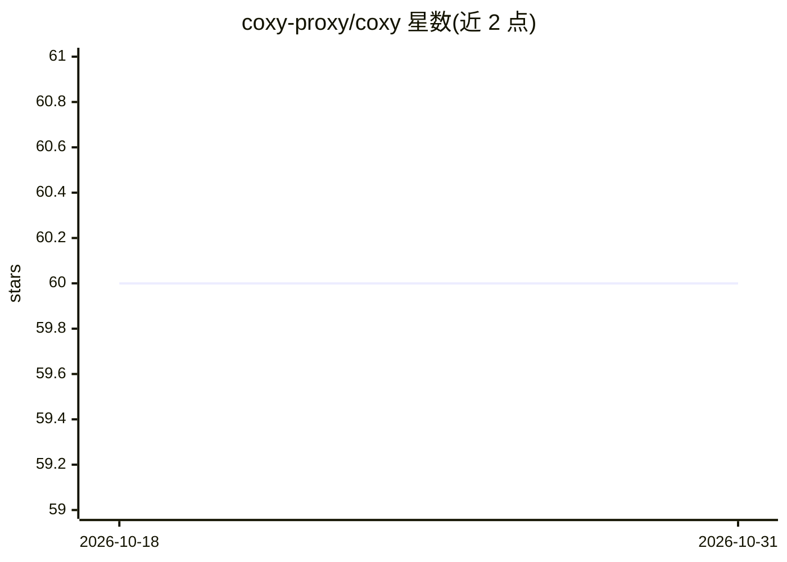

# coxy-proxy/coxy

⭐ 60 · TypeScript · MIT · 推送 2025-11-06 · [GitHub](https://github.com/coxy-proxy/coxy) · [官网](https://coxy.vercel.app) · 个人维护

**将 GitHub Copilot 转为 OpenAI 兼容 API 的代理服务器**

把 api.githubcopilot.com 的请求代理为 OpenAI 兼容接口，提供 /chat/completions 与 /models 端点，使 GitHub Copilot 的配额可在 VS Code 之外的 LLM 客户端使用。带管理 UI：GitHub 登录生成 token、手动添加 token、多 token 管理与用量统计，附简单聊天机器人与会话历史。支持默认 token 与哑 token 机制，数据存于 sqlite（Prisma）。面向拥有 Copilot 配额、想以 OpenAI 客户端调用的开发者，需 Node.js 22+ 或 Docker 运行。

## 筛选速览

| 维度 | 判定 | 备注 |
|---|---|---|
| AI 角色 | `ai-ecosystem` | LLM/agent 周边工具 |
| 许可风险 | `permissive` | MIT |
| 部署形态 | `self-host` | docker 或自建部署 |
| 模型依赖 | — | README 未给出锁定关系 |
| 硬件要求 | — | 无带数字的原话,不猜 |
| 安装摩擦 | `low` | 无编译、无系统依赖或容器化 |
| 成熟度 | — | 结构信号不足 |

## 能力要点

- 代理 api.githubcopilot.com 并暴露 OpenAI 兼容的 /chat/completions 与 /models
- 管理 UI：GitHub 登录生成 token、多 token 管理、用量统计
- 默认 token 与哑 token `_` 处理要求非空 API key 的客户端
- sqlite 数据库持久化，支持 PORT/LOG_LEVEL/DATABASE_URL 环境变量

## 适用场景

- 在本地 LLM CLI 中使用 GitHub Copilot 配额
- 通过 Open WebUI 与 GitHub Copilot 模型对话
- 整合多个 GitHub 账号的 Copilot 配额统一调用

## 场景标签

`模型网关` · 领域:Agent 开发

## 证据(README 行号)

> L3:  GitHub Copilot as OpenAI-compatible APIs
> L16: - Proxies requests to `https://api.githubcopilot.com`
> L39: - Your OpenAI-compatible API base URL is `http://localhost:3000/api`

## 星数曲线

2026-10-18 60 → 2026-10-31 60（+0）

---
*卡片 v1 · prompt 1.4 · 生成 2026-10-24 · 置信度 high · 依据 README sha `b0f5c3e89aae` · [字段定义](../../DATASET.md)*
