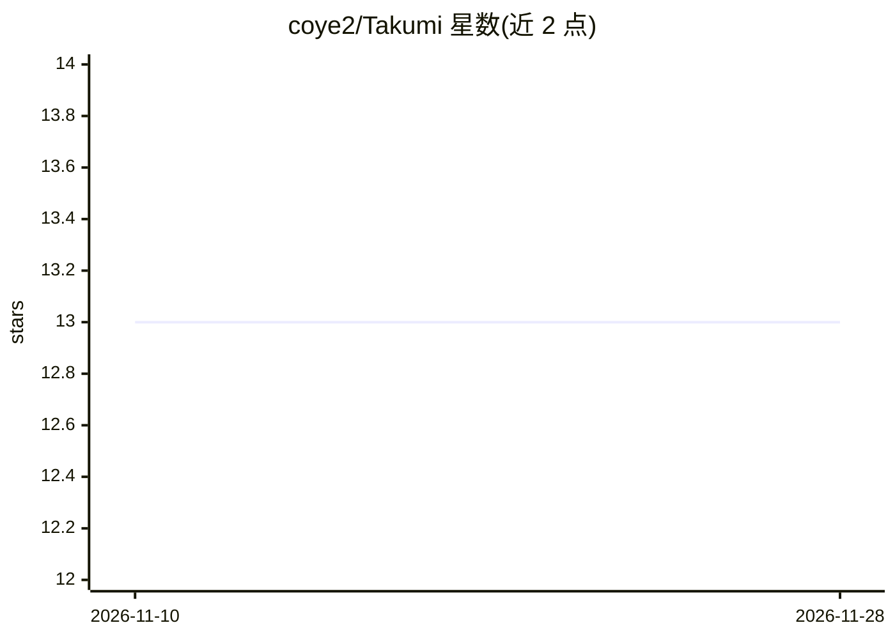

# coye2/Takumi

⭐ 13 · Python · MIT · 推送 2026-11-09 · [GitHub](https://github.com/coye2/Takumi) · 个人维护 · 中文 README

**面向开发者的 Windows 本地 AI 工作台：聊天与编码**

开源的 Windows 桌面本地 AI 工作区，将本地模型、项目文件、编码工具和研究整合到同一界面，支持保存会话与显示任务进度。提供 Sumi 1.1（完整本地模型档）与 Rei 1.1（低内存档）两个配置，Kage 面板提供任务协调与角色伴侣。推理通过本地 Ollama 服务进行；编码模式需另行安装 OpenCode CLI；Verified build 为可选项，由模型编辑项目并运行构建与测试后从错误修复。会话与设置存储在 ~/.takumi。

## 筛选速览

| 维度 | 判定 | 备注 |
|---|---|---|
| AI 角色 | `ai-native` | 本体是模型或模型工具 |
| 许可风险 | `permissive` | MIT |
| 部署形态 | `desktop` | 安装包/桌面程序 |
| 模型依赖 | local-ok | 支持本地模型 |
| 硬件要求 | `gpu-8g` | |
| 安装摩擦 | `high` | 编译与系统依赖俱全 |
| 成熟度 | `idea` | |

## 能力要点

- 本地推理默认走本机 Ollama 服务，会话与笔记存储在 ~/.takumi
- Sumi 1.1 / Rei 1.1 两个模型档，分别面向 16 GB 与 8 GB GPU 显存的机器
- Verified build 可选流程：模型编辑项目、运行构建与测试并从错误修复
- 可选集成：research providers、Figma MCP、Discord bot、手机私有访问

## 适用场景

- 在本地桌面与模型对话讨论想法并保存会话
- 配合 OpenCode 引擎对真实项目进行编辑与命令执行
- 在小内存机器上用 Rei 档运行较小的本地模型
- 用 Verified build 让模型自行跑构建和测试并核对修改

## 场景标签

`编码 Agent` `AI 助手` · 领域:编码与开发

## 证据(README 行号)

> L22: Takumi is an open-source Windows workspace for local AI chat and coding. It brings your model, project files, codin
> L55: Conversations, settings and project notes are stored under `~/.takumi`. Model inference uses your local Ollama serv

## 星数曲线

2026-11-10 13 → 2026-11-28 13（+0）

---
*卡片 v1 · prompt 1.4 · 生成 2026-11-18 · 置信度 high · 依据 README sha `3439bf477efd` · [字段定义](../../DATASET.md)*
