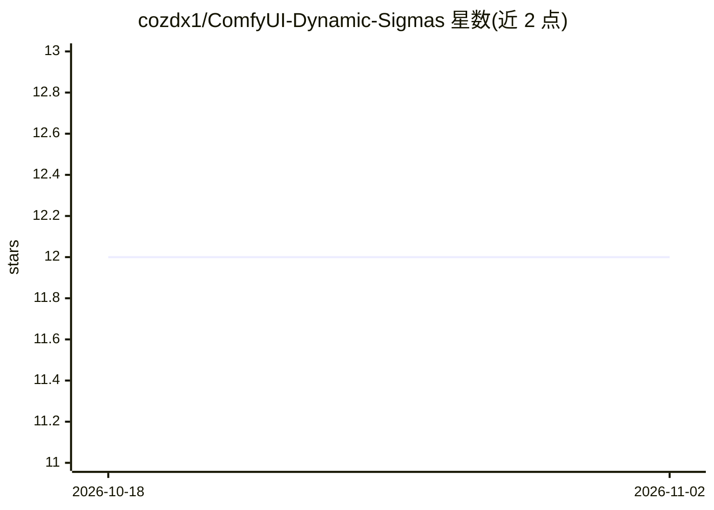

# cozdx1/ComfyUI-Dynamic-Sigmas

⭐ 12 · JavaScript · MIT · 推送 2026-09-14 · [GitHub](https://github.com/cozdx1/ComfyUI-Dynamic-Sigmas) · 个人维护 · 中文 README

**ComfyUI 自定义 sigma 调度节点：可视化编辑与拼接扩散采样曲线**

ComfyUI 自定义节点集（4 个节点），用于创建、编辑、检查与拼接扩散模型的 sigma 调度表：交互式图形直接拖拽控制点，支持端点、curve_factor、单调平滑等塑形参数；提供 Illustrious/SDXL、WAN、Flux2、Qwen-Image 等 9 种模型族起始曲线（仅为预设非自动检测）；Graph Sigmas 渲染预览图、Concat Sigmas 拼接多段调度、Sigmas to Scheduler Func 可桥接 Impact Pack Detailer 等节点。支持 11 种调度器实时预览，步骤值可逐步编辑。限制：不校验自定义调度是否适配具体模型/采样器。

## 筛选速览

| 维度 | 判定 | 备注 |
|---|---|---|
| AI 角色 | `ai-ecosystem` | LLM/agent 周边工具 |
| 许可风险 | `permissive` | MIT |
| 部署形态 | `library` | 以包/库形式分发 |
| 模型依赖 | — | README 未给出锁定关系 |
| 硬件要求 | — | 无带数字的原话,不猜 |
| 安装摩擦 | `low` | 无编译、无系统依赖或容器化 |
| 成熟度 | — | 结构信号不足 |

## 能力要点

- 交互式图形编辑 sigma 曲线，支持控制点拖拽与逐步数值编辑
- 9 种模型族预设曲线与 11 种调度器实时预览
- Concat Sigmas 去重边界拼接多段调度表
- SIGMAS→SCHEDULER_FUNC 桥接 Impact Pack FaceDetailer 等节点

## 适用场景

- 为 SDXL/Flux/WAN 等扩散模型定制采样噪声调度曲线
- 拼接多段 sigma 调度实现分段采样策略
- 将自定义调度接入 FaceDetailer 等 Detailer 节点

## 场景标签

`图像生成` · 领域:内容生成

## 证据(README 行号)

> L5: Create, reshape, inspect, combine, and reuse custom sigma schedules in ComfyUI. Model-family profiles provide practi
> L33: ### [cozdx1] Dynamic Sigma Scheduler

## 星数曲线

2026-10-18 12 → 2026-11-02 12（+0）

---
*卡片 v1 · prompt 1.4 · 生成 2026-11-01 · 置信度 mid · 依据 README sha `685cb0a12697` · [字段定义](../../DATASET.md)*
