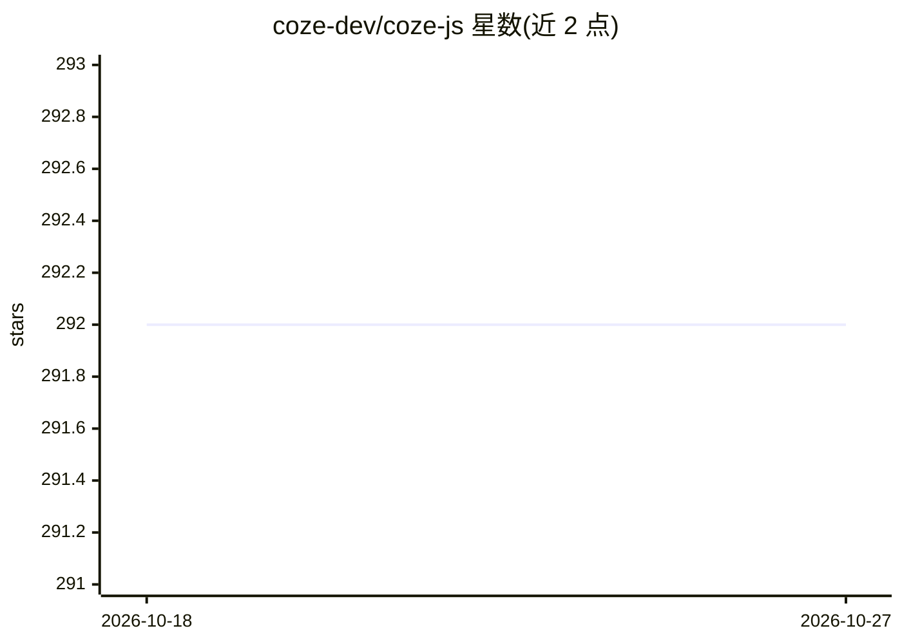

# coze-dev/coze-js

⭐ 292 · TypeScript · MIT · 推送 2026-05-18 · [GitHub](https://github.com/coze-dev/coze-js) · [官网](https://www.coze.cn/docs/developer_guides/coze_api_overview) · 组织维护 · 中文 README

**面向开发者的 Coze API JavaScript SDK monorepo**

coze-dev 维护的 Coze API 官方 JavaScript SDK monorepo，包含四个 npm 包：@coze/api（通用 API SDK）、@coze/realtime-api（实时 API SDK）、@coze/taro-api 与 @coze/uniapp-api（小程序 SDK）。examples 目录提供 Node.js、React、Taro、UniApp、WebSocket 实时对话、同声传译扩展、OAuth Server 等 13 个示例工程。开发环境要求 Node.js 18+、pnpm 9.12.0 与 Rush 5.140.0，通过 git clone 源码、rush update/build 构建后可在仓库内独立开发各包并发布。MIT 许可。

## 筛选速览

| 维度 | 判定 | 备注 |
|---|---|---|
| AI 角色 | `ai-ecosystem` | LLM/agent 周边工具 |
| 许可风险 | `permissive` | MIT |
| 部署形态 | `library` | 以包/库形式分发 |
| 模型依赖 | — | README 未给出锁定关系 |
| 硬件要求 | — | 无带数字的原话,不猜 |
| 安装摩擦 | `low` | 无编译、无系统依赖或容器化 |
| 成熟度 | — | 结构信号不足 |

## 能力要点

- 四个独立发布包覆盖通用 API、实时 API 与 Taro/UniApp 小程序
- 13 个示例工程（Node/React/Taro/UniApp/WebSocket/OAuth 等）
- Monorepo 基于 Rush 管理，各包可独立开发与发布

## 适用场景

- 在 Node.js 或 Web 应用中接入 Coze API
- 在小程序（Taro/UniApp）中调用 Coze API
- 基于示例工程快速搭建 Coze 实时语音/对话应用

## 场景标签

 · 领域:LLM 应用开发/SDK

## 证据(README 行号)

> L12: |@coze/api|Coze API SDK|npm|
> L13: |@coze/realtime-api|Realtime API SDK|npm|

## 星数曲线

2026-10-18 292 → 2026-10-27 292（+0）

---
*卡片 v1 · prompt 1.4 · 生成 2026-10-22 · 置信度 high · 依据 README sha `3dd34af05460` · [字段定义](../../DATASET.md)*
