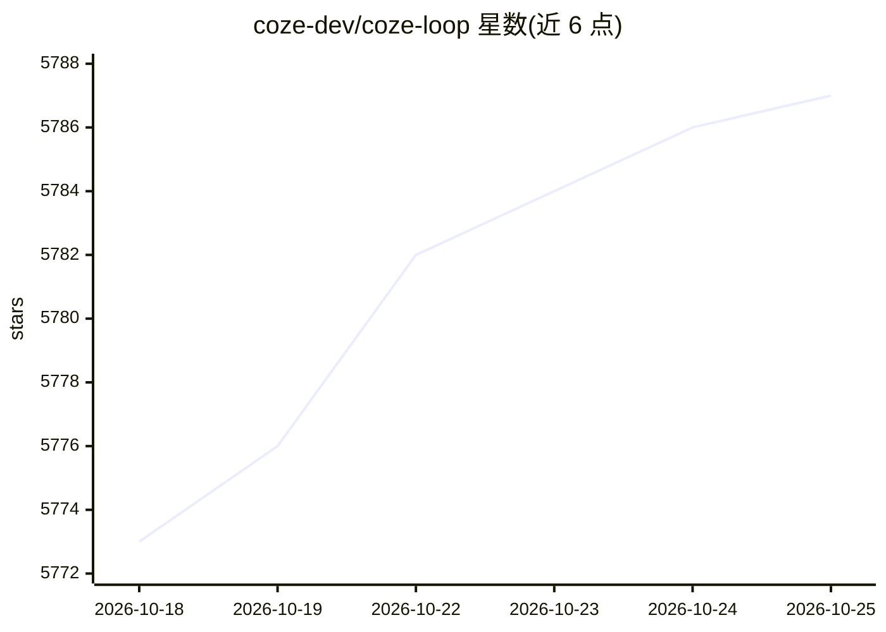

# coze-dev/coze-loop

⭐ 5,787 · Go · Apache-2.0 · 推送 2026-10-24 · [GitHub](https://github.com/coze-dev/coze-loop) · 组织维护 · 中文 README

**面向开发者的 AI Agent 全生命周期管理平台（开发/调试/评测/监控）**

字节跳动 Coze 团队开源的 AI Agent 开发运维平台级方案，基于其商业版提炼核心模块：Prompt 可视化 Playground 调试与版本管理、Prompt 与 Agent 输出的自动化多维度评测（准确性/简洁性/合规性）、全链路 Trace 观测（记录模型调用与工具执行并捕获异常）。通过 Eino 框架接入 OpenAI、火山引擎 Ark 等多种 LLM，提供三语言 SDK。部署方式为 Docker Compose 或 Kubernetes Helm Chart，需预先配置模型 api_key。README 提示公网部署存在注册功能、SSRF 等安全风险，需自行防护。Apache 2.0 许可。

## 筛选速览

| 维度 | 判定 | 备注 |
|---|---|---|
| AI 角色 | `ai-ecosystem` | LLM/agent 周边工具 |
| 许可风险 | `permissive` | Apache-2.0 |
| 部署形态 | `self-host` | docker 或自建部署 |
| 模型依赖 | — | README 未给出锁定关系 |
| 硬件要求 | — | 无带数字的原话,不猜 |
| 安装摩擦 | `low` | 无编译、无系统依赖或容器化 |
| 成熟度 | — | 结构信号不足 |

## 能力要点

- Prompt Playground 调试、多 LLM 输出对比与版本管理
- 自动化评测引擎：评测集管理、实验管理与多维统计
- SDK Trace 上报与全执行过程观测
- 通过 Eino 框架接入 OpenAI、Volcengine Ark 等模型，提供三语言 SDK

## 适用场景

- 团队对 Agent 的 Prompt 做迭代调试与版本管理
- 上线前对 Prompt/Agent 输出做自动化评测
- 运行期追踪 Agent 全链路 Trace、定位模型调用与工具执行异常

## 场景标签

`提示工程` `LLM 可观测性` `模型评测` · 领域:Agent 开发

## 证据(README 行号)

> L16: Coze Loop is a developer-oriented, platform-level solution focused on the development and operation of AI agents. I
> L25: * **Evaluation**: The Coze Loop evaluation module provides developers with systematic evaluation capabilities, enab
> L26: * **Observability**: Coze Loop provides developers with observability for the entire execution process, fully recor

## 星数曲线

2026-10-18 5,773 → 2026-10-25 5,787（+14）

---
*卡片 v1 · prompt 1.4 · 生成 2026-10-20 · 置信度 high · 依据 README sha `9f30ace9bc78` · [字段定义](../../DATASET.md)*
