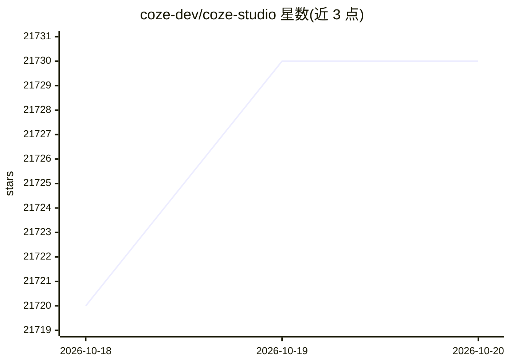

# coze-dev/coze-studio

⭐ 21,730 · TypeScript · Apache-2.0 · 推送 2026-07-29 · [GitHub](https://github.com/coze-dev/coze-studio) · 组织维护 · 中文 README

**企业/开发者的一站式可视化 AI Agent 开发平台**

Coze Studio 是一个 AI agent 开发工具，覆盖从开发到部署的全流程：提供 prompt、RAG、插件、工作流等 agent 开发核心能力，支持无代码/低代码方式通过可视化画布创建、调试和发布 agent、应用与工作流，并管理模型服务、知识库、数据库等资源。后端 Golang、前端 React + TypeScript，架构基于微服务与领域驱动设计。部署依赖 Docker/Docker Compose，最低要求 2 核 4 GB；通过 OpenAPI 与 Chat SDK 可将 agent 集成到自有业务系统；部分功能（如语气定制）仅限商业版。

## 筛选速览

| 维度 | 判定 | 备注 |
|---|---|---|
| AI 角色 | `ai-native` | 本体是模型或模型工具 |
| 许可风险 | `dual` | Apache-2.0 |
| 部署形态 | `self-host` | docker 或自建部署 |
| 模型依赖 | — | README 未给出锁定关系 |
| 硬件要求 | — | 无带数字的原话,不猜 |
| 安装摩擦 | `low` | 无编译、无系统依赖或容器化 |
| 成熟度 | — | 结构信号不足 |

## 动量与使用信号

- 维护:`active` — 距上次 push 81.2 天,年发版 3,61 位贡献者
- 涨星:近 1 天 **+3**(自 20261016 起算)
- 平台:WINDOWS / MACOS / LINUX · 协议:—

## 能力要点

- 集成 prompt、RAG、插件、工作流的 agent 开发核心能力
- 可视化画布拖拽节点构建工作流，无代码/低代码方式
- OpenAPI 与 Chat SDK 集成 agent 到自有应用
- 支持接入 OpenAI、火山引擎等模型服务

## 适用场景

- 低代码搭建 AI 助手并发布管理
- 通过 Chat SDK 在线客服等场景集成到业务系统
- 可视化构建承载业务逻辑的工作流

## 场景标签

`Agent 框架` `聊天机器人` `工作流自动化` · 领域:Agent 开发

## 证据(README 行号)

> L15: Coze Studio is an all-in-one AI agent development tool. Providing the latest large models and tools, various develo
> L17: * **Provides all core technologies needed for AI agent development**: prompt, RAG, plugin, workflow, enabling devel
> L22: The backend of Coze Studio is developed using Golang, the frontend uses React + TypeScript, and the overall archite

## 星数曲线

2026-10-18 21,720 → 2026-10-20 21,730（+10）

---
*卡片 v1 · prompt 1.4 · 生成 2026-10-18 · 置信度 high · 依据 README sha `87fc363ac5e3` · [字段定义](../../DATASET.md)*
