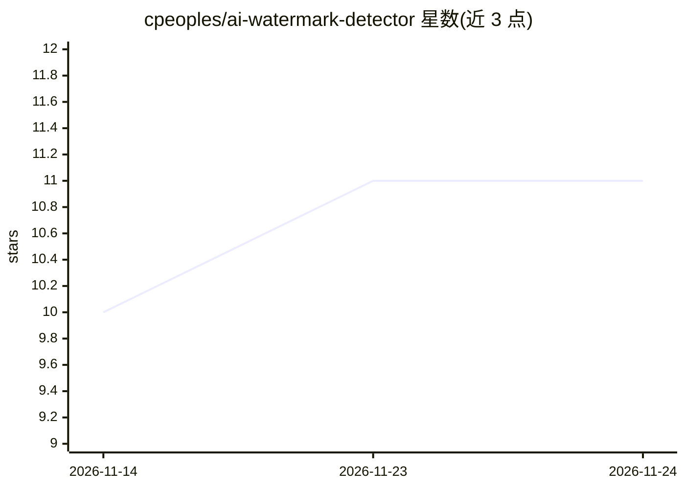

# cpeoples/ai-watermark-detector

⭐ 11 · Rust · MIT · 推送 2026-09-05 · [GitHub](https://github.com/cpeoples/ai-watermark-detector) · 个人维护

**检测文本水印与验证 C2PA 文件溯源的 Rust CLI 工具**

单一 Rust 二进制的命令行工具：对文本按六种统计水印方案（kgw/synthid/exp/unigram/sweet/exp-edit）打分，对 jpg/png/mp4/wav/pdf 文件做 C2PA 签名溯源核验并输出 TRUSTED/UNTRUSTED/TAMPERED 判定，另有扫描 git 历史中 AI 编码代理标记的 commits 命令。文本水印需持有密钥才能检测，README 明确无法仅凭原始文本判定 ChatGPT/Claude/Gemini 输出；C2PA 检查依赖外部 c2patool。支持 JSON/XML/YAML 输出，Python 工具仅限贡献者验证用。

## 筛选速览

| 维度 | 判定 | 备注 |
|---|---|---|
| AI 角色 | `ai-native` | 本体是模型或模型工具 |
| 许可风险 | `permissive` | MIT |
| 部署形态 | `desktop` | 安装包/桌面程序 |
| 模型依赖 | — | README 未给出锁定关系 |
| 硬件要求 | — | 无带数字的原话,不猜 |
| 安装摩擦 | `medium` | 含编译或系统依赖之一 |
| 成熟度 | `idea` | |

## 能力要点

- 六种文本水印方案的位级复现实现
- C2PA 签名清单核验，含证书信任链与篡改检测
- score/check/scan/commits 四个子命令，JSON/XML/YAML 输出
- 单二进制离线运行，文本打分无需外部工具

## 适用场景

- 水印研究：用已知密钥在自己生成的文本上验证水印机制
- 核验带 C2PA 溯源签名的图片/视频/音频/PDF 文件
- 批量扫描文件目录生成各格式溯源覆盖率表
- 扫描 git 提交历史中的 AI 编码代理使用痕迹

## 场景标签

 · 领域:内容安全/内容鉴证

## 证据(README 行号)

> L10: Checks whether a piece of **text** or a **file** (image / video / audio / PDF) carries one
> L13: official papers, plus **forensic C2PA** file-provenance verification.
> L104: |`score`|Scores token IDs against a text watermark (kgw/synthid/exp/unigram/sweet/exp-edit)|Yes (the vendor's, or 

## 星数曲线

2026-11-14 10 → 2026-11-24 11（+1）

---
*卡片 v1 · prompt 1.4 · 生成 2026-11-19 · 置信度 mid · 依据 README sha `0dc8695f3b71` · [字段定义](../../DATASET.md)*
