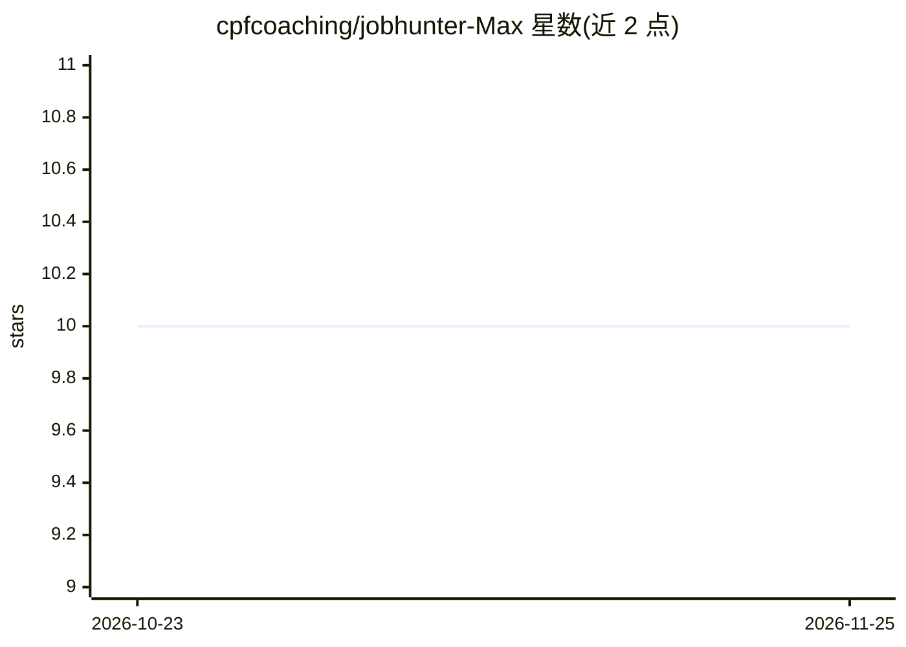

# cpfcoaching/jobhunter-Max

⭐ 10 · TypeScript · 推送 2026-11-23 · [GitHub](https://github.com/cpfcoaching/jobhunter-Max) · 个人维护

**求职管理应用：跟踪公司与投递，AI 优化简历与邮件**

React + TypeScript 的 Web 应用，前后端分离（Node.js/Express 后端管理 API key，AES-256-GCM 加密存储）。手动部分覆盖公司/联系人/沟通记录/日程/面试准备等求职流程管理；AI 部分提供简历评分（0-100）、简历与职位描述匹配分析、AI 邮件生成，支持 Ollama 本地模型或 OpenAI/DeepSeek 云端，AI 功能为可选，需单独配置。安装需 Node.js 18+，git clone 后 npm install 运行开发服务器。

## 筛选速览

| 维度 | 判定 | 备注 |
|---|---|---|
| AI 角色 | `ai-native` | 本体是模型或模型工具 |
| 许可风险 | `none` | — |
| 部署形态 | `library` | 以包/库形式分发 |
| 模型依赖 | local-ok | 支持本地模型 |
| 硬件要求 | — | 无带数字的原话,不猜 |
| 安装摩擦 | `low` | 无编译、无系统依赖或容器化 |
| 成熟度 | — | 结构信号不足 |

## 能力要点

- 简历评分与职位匹配分析（匹配/缺失技能分解）
- AI 邮件生成，含介绍/跟进/感谢信等模板
- Ollama 本地运行可选，API key 后端加密存储
- 求职流程手动跟踪：公司/联系人/沟通/日程管理

## 适用场景

- 集中管理多家公司的投递进度与联系人沟通记录
- 投递前让 AI 评分简历并对比职位描述找差距
- 本地 Ollama 模型生成跟进邮件，简历不上传云端

## 场景标签

`AI 写作` · 领域:内容生成

## 证据(README 行号)

> L5: JobHunter Max is a modern, full-featured job search management application that brings together the best of both wor
> L72: **AI Resume Review**
> L103: - **Ollama** (Local, Privacy-First) - Run AI models on your machine

## 星数曲线

2026-10-23 10 → 2026-11-25 10（+0）

---
*卡片 v1 · prompt 1.4 · 生成 2026-11-19 · 置信度 high · 依据 README sha `536cb0dc7eec` · [字段定义](../../DATASET.md)*
