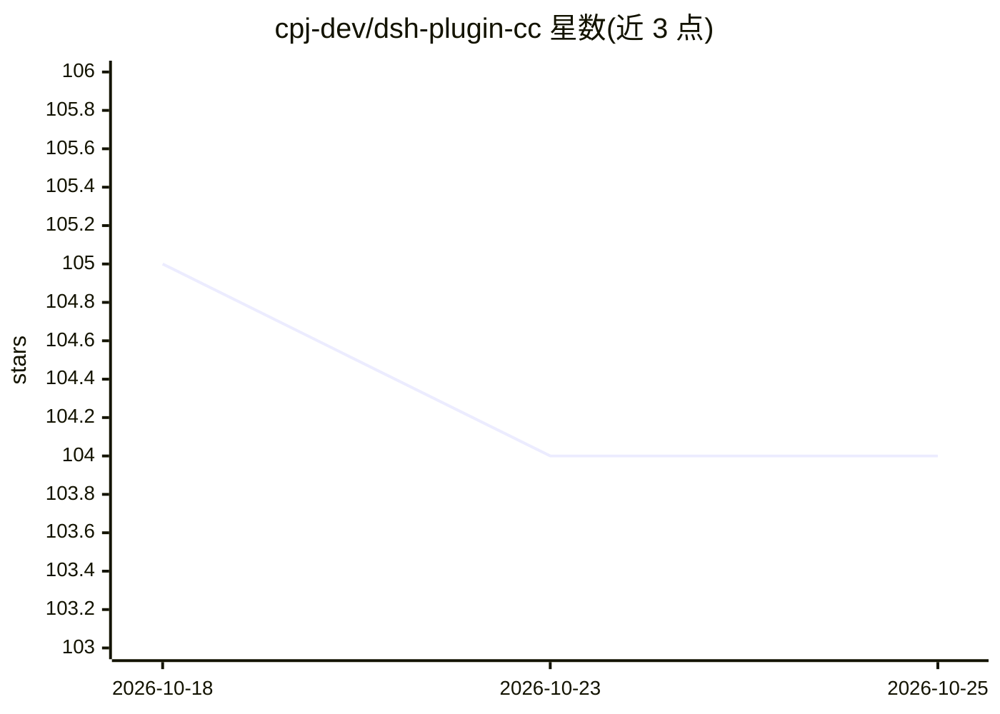

# cpj-dev/dsh-plugin-cc

⭐ 104 · JavaScript · MIT · 推送 2026-08-27 · [GitHub](https://github.com/cpj-dev/dsh-plugin-cc) · 个人维护 · 中文 README

**在 Claude Code 中运行 DeepSeek Harness 的斜杠命令插件**

面向 Claude Code 用户的插件，通过斜杠命令调用 DeepSeek Harness（dsh）：提供本地变更只读审查、结构化对抗式 critique、一次性任务、可恢复多轮会话与后台委派等能力，并可把当前对话弱导入为 dsh 会话。Agent 模式有 standard/minimal/anchored-standard 三种，控制模型可见的工具目录。安装走插件市场命令，需要 Node>=20 与 DEEPSEEK_API_KEY。v1 限制：无中途审批、POSIX only（Windows 不支持）、不转发图像给 DSH。

## 筛选速览

| 维度 | 判定 | 备注 |
|---|---|---|
| AI 角色 | `ai-ecosystem` | LLM/agent 周边工具 |
| 许可风险 | `permissive` | MIT |
| 部署形态 | `None` |  |
| 模型依赖 | locked-api |  |
| 硬件要求 | — | 无带数字的原话,不猜 |
| 安装摩擦 | `low` | 无编译、无系统依赖或容器化 |
| 成熟度 | — | 结构信号不足 |

## 能力要点

- 斜杠命令覆盖 review/critique/run/delegate/import 等能力
- 三种 agent 模式控制模型可见工具目录
- 可恢复多轮会话（--session/--resume/--dsh:import）与共享 broker
- 固定 dsh 版本（pin @0.1.1-rc.2），升级需重跑 /dsh:setup

## 适用场景

- 在 Claude Code 里让 DeepSeek 模型审查或批判本地代码变更
- 把任务委派给 DeepSeek Harness 后台执行
- 将 Claude Code 对话导入为可恢复的 dsh 会话

## 场景标签

`编码 Agent` `代码审查` · 领域:编码与开发

## 证据(README 行号)

> L9: Claude Code plugin that runs **DeepSeek Harness** (`dsh`) from slash commands: review, critique, one-shot tasks, and
> L33: Needs Node >= 20 and a `DEEPSEEK_API_KEY`. `/dsh:setup` also needs Node >= 22.19, `npm`, and `pnpm` (`corepack enab

## 星数曲线

2026-10-18 105 → 2026-10-25 104（-1）

---
*卡片 v1 · prompt 1.4 · 生成 2026-10-23 · 置信度 high · 依据 README sha `6942032a087b` · [字段定义](../../DATASET.md)*
