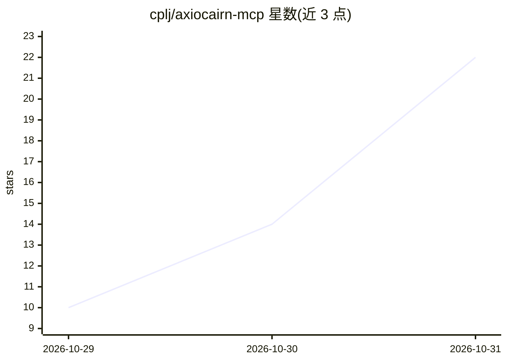

# cplj/axiocairn-mcp

⭐ 22 · Python · MIT · 推送 2026-10-30 · [GitHub](https://github.com/cplj/axiocairn-mcp) · 组织维护

**托管 MCP 服务器：向 AI 代理提供市场简报与股票模型评估报告**

Axiocairn 运营的托管 MCP 服务器（https://axiocairn.com/mcp），让 Claude、ChatGPT 等 MCP 客户端检索已发布的市场研究报告，报告附带数据日期、缺失字段与局限性说明。提供按日/按类型/按 ticker 检索、报告排期查询、House View 周报等工具。无需本地安装，账户授权后使用；Reader 为免费档，含延迟简报与受限历史窗口。本仓库仅含文档与连接元数据，不含服务实现。

## 筛选速览

| 维度 | 判定 | 备注 |
|---|---|---|
| AI 角色 | `ai-ecosystem` | LLM/agent 周边工具 |
| 许可风险 | `permissive` | MIT |
| 部署形态 | `None` |  |
| 模型依赖 | locked-api |  |
| 硬件要求 | — | 无带数字的原话,不猜 |
| 安装摩擦 | `low` | 无编译、无系统依赖或容器化 |
| 成熟度 | — | 结构信号不足 |

## 能力要点

- 六个工具：按日/类型/ticker/语言检索报告与排期查询
- 报告附带数据截止日期、缺失字段与失效条件
- 无本地安装，Streamable HTTP + 账户授权（Google/GitHub）
- Claude（web）与 ChatGPT（web）连接已于 2026-10-27 验证

## 适用场景

- 在 Claude 或 ChatGPT 中直接查询当日可用的市场简报及其数据日期
- 按 ticker 检索某只股票已发布的研究报告
- 核验本周 House View 是否发布及下次发布时间

## 场景标签

`金融量化` · 领域:学习与行业

## 证据(README 行号)

> L3: Axiocairn MCP lets AI agents retrieve published market research reports, their data dates, and their limitations.
> L38: Connect to the hosted server at **https://axiocairn.com/mcp** using Streamable HTTP and the account authorization f

## 星数曲线

2026-10-29 10 → 2026-10-31 22（+12）

---
*卡片 v1 · prompt 1.4 · 生成 2026-10-30 · 置信度 high · 依据 README sha `5ac5b9c3ee41` · [字段定义](../../DATASET.md)*
