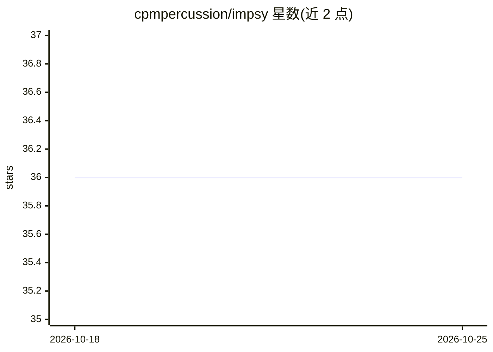

# cpmpercussion/impsy

⭐ 36 · Python · MIT · 推送 2026-09-27 · [GitHub](https://github.com/cpmpercussion/impsy) · [官网](http://charlesmartin.au/impsy/) · 个人维护

**创建智能乐器的平台：MDRNN 预测演奏者下一步输入**

面向乐器演奏者与音乐技术创作者的 Python 平台：用混合密度循环神经网络（MDRNN）观察多步控制输入，预测每个维度的下一数值与发生时间；通过 MIDI、OSC、WebSocket、串口与乐器/合成器软硬件通信，支持 call-response 即兴等交互模式。使用中的输入会被记录为日志，可整理成数据集并训练新模型（CPU 可训，不需 GPU）。提供 PyPI 安装、Raspberry Pi 预构建镜像、iOS/macOS AUv3 插件与浏览器版本；训练也可在 Google Colab 或内置 Web UI 完成。

## 筛选速览

| 维度 | 判定 | 备注 |
|---|---|---|
| AI 角色 | `ai-native` | 本体是模型或模型工具 |
| 许可风险 | `permissive` | MIT |
| 部署形态 | `self-host` | docker 或自建部署 |
| 模型依赖 | — | README 未给出锁定关系 |
| 硬件要求 | — | 无带数字的原话,不猜 |
| 安装摩擦 | `low` | 无编译、无系统依赖或容器化 |
| 成熟度 | `idea` | |

## 能力要点

- MDRNN 对 1-16 维连续控制输入做下一值与时间预测
- MIDI/OSC/WebSocket/串口多协议输入输出接口
- 交互自动记录为日志并可整理数据集训练新模型（.tflite 输出）
- 覆盖桌面 Python、Raspberry Pi、iOS/macOS AUv3 与浏览器多前端

## 适用场景

- 让合成器/控制器与我 call-response 即兴演奏
- 搭建自己的智能乐器并逐步积累专属训练数据
- 在 Raspberry Pi 上运行嵌入式音乐预测系统

## 场景标签

`模型训练` · 领域:训练与推理

## 证据(README 行号)

> L13: IMPSY uses a mixture density recurrent neural network (MDRNN) to observe control inputs over multiple time steps, p
> L14: It provides input and output interfaces over MIDI, OSC, WebSockets, and serial and can work with musical interfaces

## 星数曲线

2026-10-18 36 → 2026-10-25 36（+0）

---
*卡片 v1 · prompt 1.4 · 生成 2026-10-25 · 置信度 mid · 依据 README sha `3e936f13badd` · [字段定义](../../DATASET.md)*
