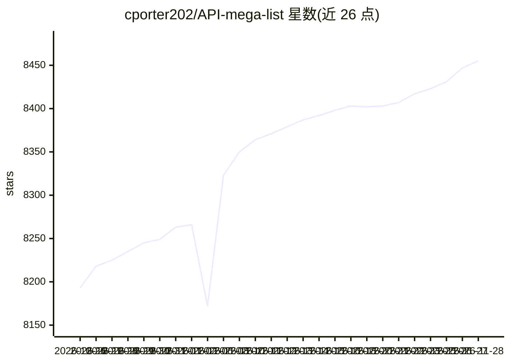

# cporter202/API-mega-list

⭐ 8,455 · JavaScript · 推送 2026-11-27 · [GitHub](https://github.com/cporter202/API-mega-list) · 个人维护

**收录 11,860 个 API 的分类目录清单，供开发者检索取用**

以 awesome-list 形式维护的 API 聚合目录，按 Agents、AI、Automation、Developer Tools、MCP Servers 等 24 个类别组织 11,860 条核心 API 条目，另有 200 个赞助合作条目；条目以表格列出名称与描述，多数为付费/按量计费的商业 API（如爬虫、内容生成工具）。README 含赞助位售卖信息与 Trendshift 排名声明，可见部分未提供本地安装方式，条目需自行前往对应服务接入。

## 筛选速览

| 维度 | 判定 | 备注 |
|---|---|---|
| AI 角色 | `ai-knowledge` | 知识聚合/清单类 |
| 许可风险 | `none` | — |
| 部署形态 | `None` |  |
| 模型依赖 | — | README 未给出锁定关系 |
| 硬件要求 | — | 无带数字的原话,不猜 |
| 安装摩擦 | `medium` | 含编译或系统依赖之一 |
| 成熟度 | — | 结构信号不足 |

## 能力要点

- 按 24 个类别组织 11,860 条 API 条目
- 含 Agents（623）、AI（1,555）、MCP Servers（289）等 AI 相关分类
- 条目附名称、描述与价格信息（如按千次计费）
- 声明定期更新（Last Updated 2026-07-23）

## 适用场景

- 为自动化或数据采集项目查找可用 API
- 按类别浏览 AI、Agent、MCP 类商业 API 生态
- 寻找社媒、电商、房产等领域的爬取类 API

## 场景标签

`精选清单` · 领域:学习与行业

## 证据(README 行号)

> L5: **The most comprehensive collection of APIs on GitHub** - 11,860 core directory APIs plus 200 sponsored partner list
> L55: |**Categories**|**24**|
> L103: - Agents - 623 APIs

## 星数曲线

2026-10-26 8,193 → 2026-11-28 8,455（+262）

---
*卡片 v1 · prompt 1.4 · 生成 2026-11-28 · 置信度 high · 依据 README sha `39245ff70395` · [字段定义](../../DATASET.md)*
