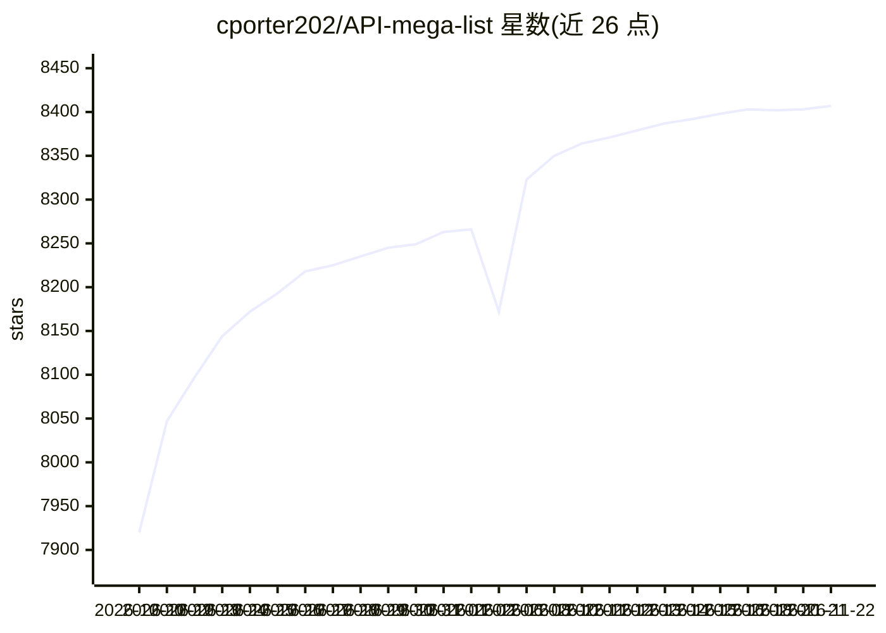

# cporter202/API-mega-list

⭐ 8,407 · JavaScript · 推送 2026-11-19 · [GitHub](https://github.com/cporter202/API-mega-list) · 个人维护

**面向开发者的 11,860 条 API 目录清单（24 类）**

收录 11,860 条核心目录 API 及 200 条赞助商合作条目的聚合清单，按 Agents、AI、Automation、Developer Tools、MCP Servers、Ecommerce、Social Media 等 24 个类别组织，多数条目为按调用计费的第三方付费 API（含 Apify 风格的爬虫与自动化服务）。用途覆盖数据采集、工作流自动化、市场分析、线索获取、电商监控与 AI 集成等场景。README 含赞助商板块（APIMesa），并按类别列出条目表。

## 筛选速览

| 维度 | 判定 | 备注 |
|---|---|---|
| AI 角色 | `ai-knowledge` | 知识聚合/清单类 |
| 许可风险 | `none` | — |
| 部署形态 | `None` |  |
| 模型依赖 | — | README 未给出锁定关系 |
| 硬件要求 | — | 无带数字的原话,不猜 |
| 安装摩擦 | `medium` | 含编译或系统依赖之一 |
| 成熟度 | `idea` | |

## 能力要点

- 11,860 条核心目录 API 与 200 条赞助商条目
- 按 24 个类别组织，含 Agents（623）、AI（1,555）、MCP Servers（289）等分类
- 覆盖数据采集、自动化、电商、社交媒体等多领域条目
- 含赞助商板块 APIMesa（150+ API，单 key）

## 适用场景

- 为爬虫或自动化项目查找现成的第三方 API
- 按类别浏览 AI/Agent/MCP 相关的付费 API 资源
- 寻找电商、社媒、房产等垂直领域的数据接口

## 场景标签

`精选清单` · 领域:学习与行业

## 证据(README 行号)

> L39: |**Core directory APIs**|**11,860**|
> L68: - Agents - 623 APIs
> L69: - AI - 1,555 APIs

## 星数曲线

2026-10-20 7,920 → 2026-11-22 8,407（+487）

---
*卡片 v1 · prompt 1.4 · 生成 2026-11-22 · 置信度 high · 依据 README sha `f33592cb9477` · [字段定义](../../DATASET.md)*
