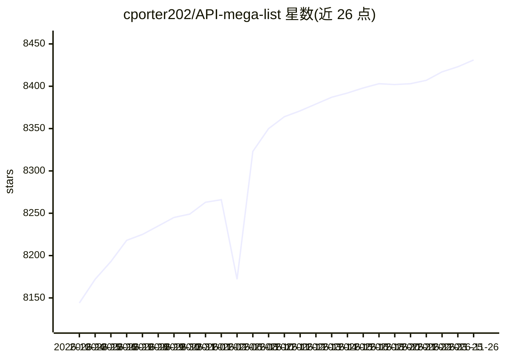

# cporter202/API-mega-list

⭐ 8,431 · JavaScript · 推送 2026-11-22 · [GitHub](https://github.com/cporter202/API-mega-list) · 个人维护

**开发者用的 API 聚合目录：11,860 个 API 按 24 类组织**

一个 API 目录清单仓库，收录 11,860 个核心目录 API 和 200 个赞助合作条目，按 Agents、AI、Automation、Developer Tools 等 24 个类别组织，以表格形式列出名称、描述与价格信息。收录条目来自 Apify 等数据采集与自动化类服务，供开发者按类别检索并在应用中集成。仓库含赞助位销售机制，README 明确说明可通过邮件付费展示第三方 API。

## 筛选速览

| 维度 | 判定 | 备注 |
|---|---|---|
| AI 角色 | `ai-knowledge` | 知识聚合/清单类 |
| 许可风险 | `none` | — |
| 部署形态 | `None` |  |
| 模型依赖 | — | README 未给出锁定关系 |
| 硬件要求 | — | 无带数字的原话,不猜 |
| 安装摩擦 | `medium` | 含编译或系统依赖之一 |
| 成熟度 | — | 结构信号不足 |

## 能力要点

- 收录 11,860 个核心目录 API，分 24 个类别
- 含 Agents（623）、AI（1,555）、MCP Servers（289）等 AI 相关分类
- 每个条目附名称、描述及部分价格信息
- README 提供赞助合作与展示位说明

## 适用场景

- 按类别查找可用于数据采集的第三方 API
- 为自动化工作流寻找现成的 API 服务
- 浏览 AI 与 MCP 服务器类 API 的生态概况

## 场景标签

`精选清单` · 领域:学习与行业

## 证据(README 行号)

> L53: |**Core directory APIs**|**11,860**|
> L97: - Agents - 623 APIs
> L110: - MCP Servers - 289 APIs

## 星数曲线

2026-10-24 8,144 → 2026-11-26 8,431（+287）

---
*卡片 v1 · prompt 1.4 · 生成 2026-11-23 · 置信度 high · 依据 README sha `46e61a790d37` · [字段定义](../../DATASET.md)*
