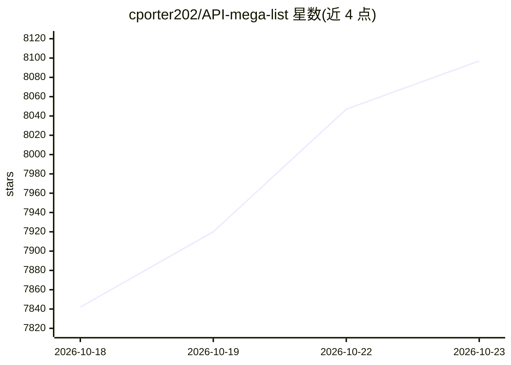

# cporter202/API-mega-list

⭐ 8,097 · JavaScript · 推送 2026-10-20 · [GitHub](https://github.com/cporter202/API-mega-list) · 个人维护

**API 目录清单：收录 11,860 个 API 供开发者选型接入**

一个以 Markdown 表格组织的 API 聚合目录，收录 11,860 个核心条目和 200 个赞助商条目，按 Agents、AI、Automation、Ecommerce、Social Media 等 24 个类别划分；条目给出名称与功能描述，覆盖数据采集、营销文案生成、爬虫、商业分析等场景，多数与 Apify 平台生态相关。仓库本身不含代码或安装方式，读者通过目录查找 API 后到对应平台使用；README 中另含付费订阅推广（aiwithchris.com）。

## 筛选速览

| 维度 | 判定 | 备注 |
|---|---|---|
| AI 角色 | `ai-knowledge` | 知识聚合/清单类 |
| 许可风险 | `none` | — |
| 部署形态 | `None` |  |
| 模型依赖 | — | README 未给出锁定关系 |
| 硬件要求 | — | 无带数字的原话,不猜 |
| 安装摩擦 | `medium` | 含编译或系统依赖之一 |
| 成熟度 | — | 结构信号不足 |

## 能力要点

- 收录 11,860 个核心 API 与 200 个赞助条目
- 24 个类别组织（Agents 623、AI 1,555、Automation 5,653 等）
- 条目为名称+描述的表格形式，覆盖采集/自动化/营销/分析场景

## 适用场景

- 开发爬虫或自动化流程前查找现成 API
- 对比同类数据采集或 AI 工具 API 的可选方案
- 了解当前可用第三方 API 的类别覆盖情况

## 场景标签

`精选清单` · 领域:学习与行业

## 证据(README 行号)

> L5: **The most comprehensive collection of APIs on GitHub** - 11,860 core directory APIs plus 200 sponsored partner list
> L41: |**Categories**|**24**|
> L68: - Agents - 623 APIs

## 星数曲线

2026-10-18 7,842 → 2026-10-23 8,097（+255）

---
*卡片 v1 · prompt 1.4 · 生成 2026-10-20 · 置信度 high · 依据 README sha `1df8c97a848a` · [字段定义](../../DATASET.md)*
