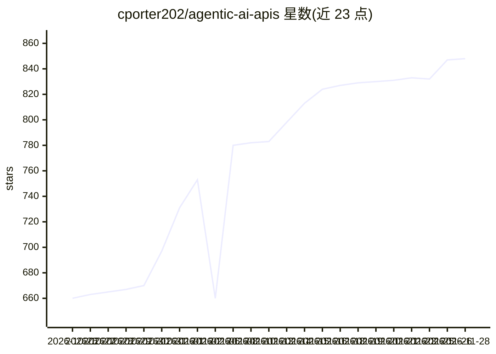

# cporter202/agentic-ai-apis

⭐ 848 · JavaScript · 推送 2026-11-27 · [GitHub](https://github.com/cporter202/agentic-ai-apis) · 个人维护

**自主 AI agent 构建 API 目录：聚合 Agents、AI Models 与 MCP Servers 三类条目**

一个面向构建自主 AI 系统的开发者 API 聚合目录，按 Agents（执行与编排）、AI Models（推理与生成服务层）、MCP Servers（通过 MCP 连接工具与数据）三个类别组织条目。README 提供按层选型的工作流程说明，条目指向各服务商页面获取实现细节、定价与文档。数据由 GitHub Actions 工作流每日同步 Apify 目录，仅在上游变更时提交；API 链接保留上游的联盟跟踪。注意：README 中 API 计数字段显示为 0，实际条目数量无法从本页核实。

## 筛选速览

| 维度 | 判定 | 备注 |
|---|---|---|
| AI 角色 | `ai-knowledge` | 知识聚合/清单类 |
| 许可风险 | `none` | — |
| 部署形态 | `None` |  |
| 模型依赖 | — | README 未给出锁定关系 |
| 硬件要求 | — | 无带数字的原话,不猜 |
| 安装摩擦 | `low` | 无编译、无系统依赖或容器化 |
| 成熟度 | — | 结构信号不足 |

## 能力要点

- 按 Agents / AI Models / MCP Servers 三类组织的 API 目录
- GitHub Actions 每日同步 Apify 目录，仅在上游数据变更时提交
- 条目链接指向服务商页面，含实现细节、定价与文档

## 适用场景

- 为 agent 项目寻找可接入的工具与模型 API
- 查找 MCP 服务器以连接外部系统与数据
- 快速建立选型候选清单而不是逐个检索服务商

## 场景标签

`精选清单` · 领域:学习与行业

## 证据(README 行号)

> L20: > The ultimate collection of APIs for building autonomous AI agents - **0 production-ready APIs** across **Agents**
> L111: - **Agents** for execution, orchestration, planning, and autonomous workflows
> L121: - A GitHub Actions workflow now syncs the Apify catalog daily and commits only when upstream data actually changes

## 星数曲线

2026-10-26 660 → 2026-11-28 848（+188）

---
*卡片 v1 · prompt 1.4 · 生成 2026-11-28 · 置信度 high · 依据 README sha `3c97625f0679` · [字段定义](../../DATASET.md)*
