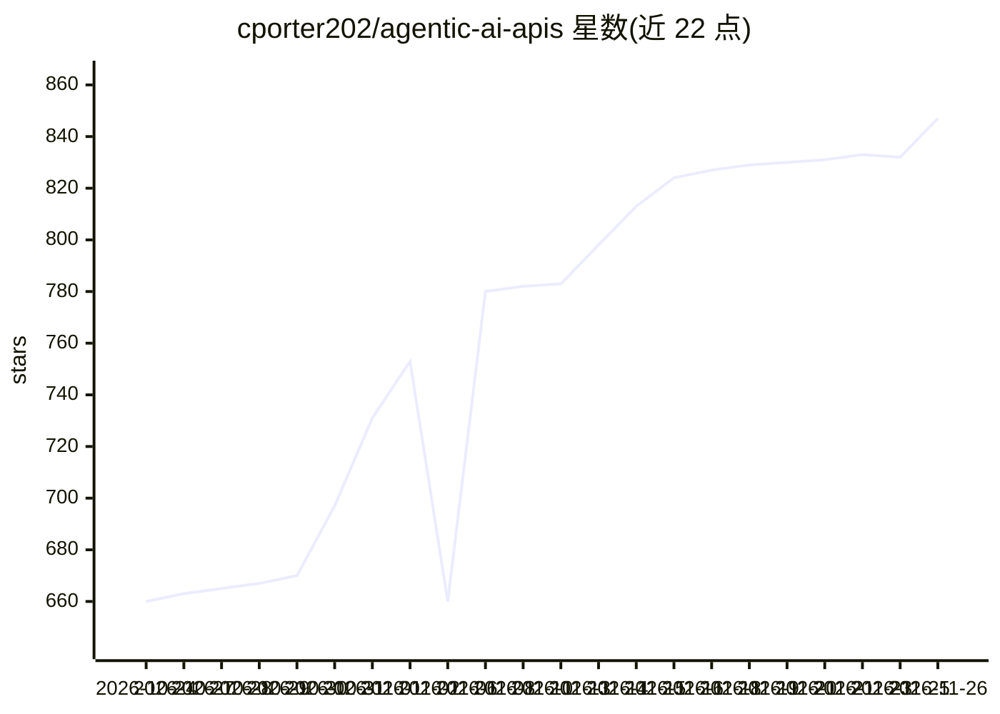

# cporter202/agentic-ai-apis

⭐ 847 · JavaScript · 推送 2026-11-25 · [GitHub](https://github.com/cporter202/agentic-ai-apis) · 个人维护

**面向 agent 开发者的 API 目录：按 3 类组织可接入 API**

一个聚合自主 AI agent 构建所需 API 的目录仓库，按 Agents（执行/编排/自主任务）、AI Models（推理/生成/抽取）、MCP Servers（工具接入）三个类别组织条目。README 不含安装与运行说明，用户通过分类 README 浏览 API 名称与描述，跳转到 provider 页面查看实现细节、定价与文档。维护侧通过 GitHub Actions 每日同步 Apify 目录，仅在上游数据变化时提交；API 链接保留上游来源的联盟跟踪参数。README 中的计数显示为 0，与描述中的 2,036 不一致。

## 筛选速览

| 维度 | 判定 | 备注 |
|---|---|---|
| AI 角色 | `ai-knowledge` | 知识聚合/清单类 |
| 许可风险 | `none` | — |
| 部署形态 | `None` |  |
| 模型依赖 | — | README 未给出锁定关系 |
| 硬件要求 | — | 无带数字的原话,不猜 |
| 安装摩擦 | `low` | 无编译、无系统依赖或容器化 |
| 成熟度 | — | 结构信号不足 |

## 能力要点

- 按 Agents、AI Models、MCP Servers 三类组织的 API 目录
- GitHub Actions 每日自动同步 Apify 目录
- 条目跳转至 provider 页面获取实现细节、定价与文档

## 适用场景

- 为 agent 项目快速筛选可接入的 API 形成候选清单
- 查找把助手接入外部系统的 MCP Server 集成
- 按执行层/模型层/工具层的分层视角了解 agentic API 生态

## 场景标签

`精选清单` · 领域:学习与行业

## 证据(README 行号)

> L20: > The ultimate collection of APIs for building autonomous AI agents - **0 production-ready APIs** across **Agents**
> L27: |Categories|3|

## 星数曲线

2026-10-24 660 → 2026-11-26 847（+187）

---
*卡片 v1 · prompt 1.4 · 生成 2026-11-26 · 置信度 high · 依据 README sha `13bd06b0ebfe` · [字段定义](../../DATASET.md)*
